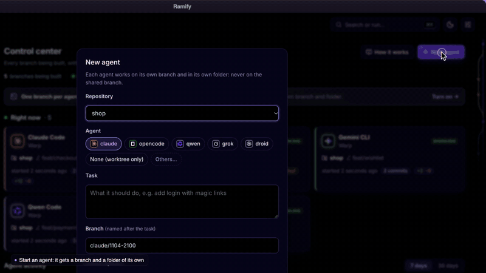
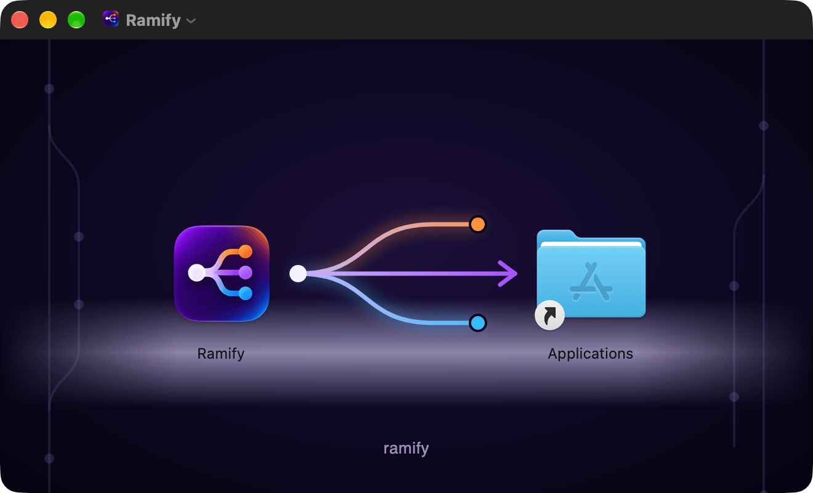
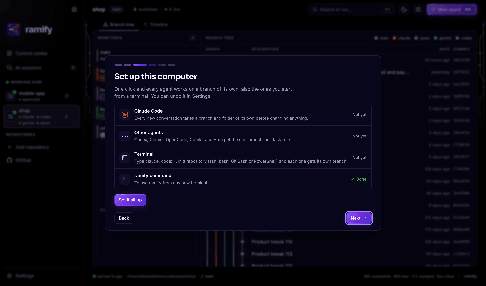
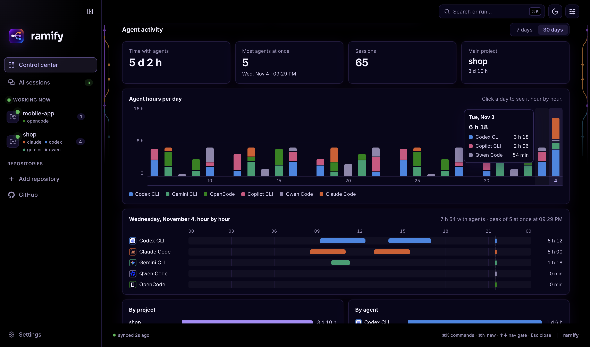
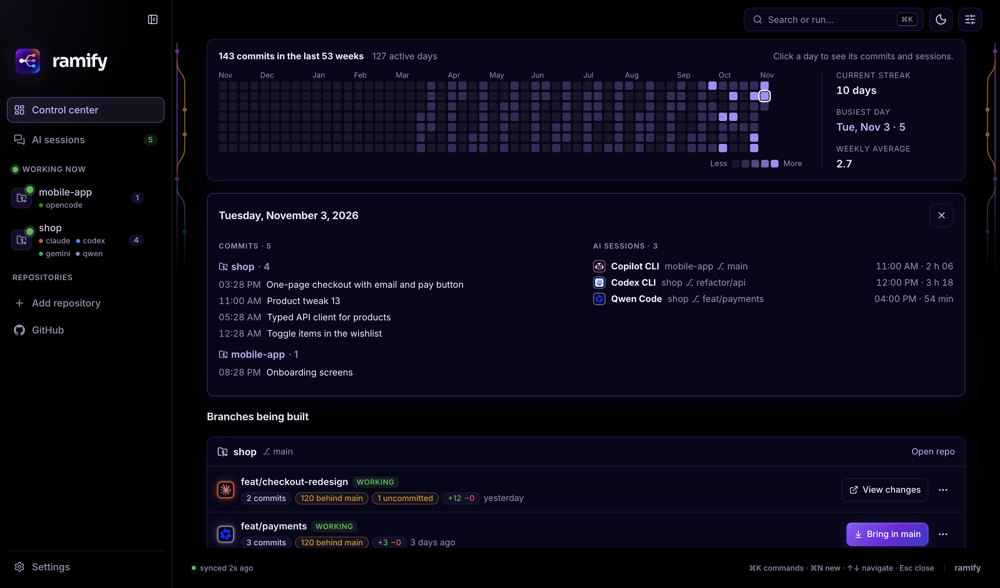
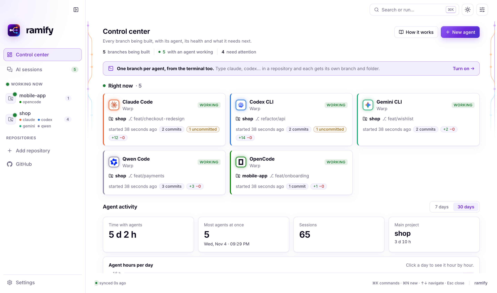

<p align="center"></p>

<h1 align="center">Ramify</h1>

<p align="center">
  <b>Trabaja con varios asistentes de IA a la vez, sin que se pisen.</b><br>
  Claude Code, Codex, Gemini, Copilot, Cursor y 35 más pueden construir partes distintas de tu proyecto al mismo
  tiempo. Ramify le da a cada uno su propio espacio, te enseña quién está haciendo qué ahora mismo y te deja llevar
  cada trabajo a tu proyecto con un clic cuando está listo.
</p>

<p align="center">
  <a href="https://github.com/diegoperezg7/ramify/releases/latest"><b>Descargar para macOS</b></a> ·
  <a href="https://github.com/diegoperezg7/ramify/releases/latest"><b>Descargar para Windows</b></a> ·
  <a href="#para-desarrolladores">CLI, extensión de editor y plugin de Claude Code</a>
</p>

<p align="center"><a href="README.md">English</a></p>

<p align="center"><a href="docs/ramify-demo.mp4"></a></p>

<p align="center"><sub><b><a href="docs/ramify-demo.mp4">▶ Ver la demo completa (55 s)</a></b>: agentes trabajando ahora, un agente nuevo y su terminal, horas de los agentes, cualquier día al detalle, las ramas y un merge con un clic</sub></p>

## En pocas palabras

Los asistentes de IA que escriben código son rápidos, y cuando pruebas a usar dos a la vez ya no quieres volver
atrás. El problema: si los pones en el mismo proyecto, se pisan el trabajo. Si le das a cada uno una copia aparte,
a la semana nadie recuerda en qué copia estaba el cambio que necesitabas.

**Ramify es el organizador de mesas de tu equipo de IA.**

- **Cada asistente tiene su propia mesa.** Una copia aparte de tu proyecto (una *rama*), preparada y lista, para
  que nadie toque el trabajo de otro. Pasa sola, también cuando abres un asistente desde la terminal.
- **Ves toda la oficina de un vistazo.** Quién está trabajando ahora, en qué, desde cuándo y qué ha cambiado. Los
  encuentra solo: no hay que configurar nada en cada herramienta.
- **Tú decides qué entra.** Cuando un trabajo está listo, ves exactamente qué ha cambiado y lo llevas a tu proyecto
  con un clic. Si algo choca, Ramify te dice por qué en palabras normales y no cambia nada.

Todo se queda en tu ordenador.

## Para quién es

- **Construyes con IA.** Usas Claude Code, Codex, Cursor o parecidos para hacer apps, webs o herramientas, y quieres
  varios trabajando a la vez sin perder el hilo.
- **Eres desarrollador.** Ya lanzas agentes en paralelo y quieres que las ramas, los puertos y las dependencias se
  resuelvan solos, con una pantalla donde ver todas las ramas en construcción.
- **Llevas un equipo pequeño.** Quieres ver por dónde va el trabajo de la IA, qué está listo y qué necesita una revisión.

## Empieza en tres pasos

**1. Instálalo.** Descarga la app para [macOS o Windows](https://github.com/diegoperezg7/ramify/releases/latest).
En Mac, arrastra Ramify a Aplicaciones.

<p align="center"></p>

**2. Deja que prepare este ordenador.** La primera vez, Ramify te enseña las herramientas de IA que ha encontrado y
te ofrece dejarlo todo listo con un clic: desde entonces cada asistente trabaja en su propia rama, también los que
abres desde una terminal. Se puede deshacer en Ajustes.

<p align="center"></p>

**3. Trabaja como siempre.** Abre tus asistentes como ya lo haces. Ramify los ve, le da a cada uno su espacio y los
muestra en el centro de control. Cuando uno termina, revisa sus cambios y llévalos a tu proyecto.

## Qué puedes hacer

### Ver quién está trabajando ahora mismo


Una tarjeta por cada asistente trabajando: cuál es, en qué proyecto y rama, desde cuándo y qué ha cambiado hasta
ahora. Si no hay nadie trabajando, te enseña dónde y con qué asistentes trabajaste por última vez. Si uno empieza a
cambiar la versión principal de tu proyecto, aparece un aviso con un botón para llevarlo a su propia rama.

### Ver cuánto y cuándo trabajan tus asistentes



La semana o el mes en cuatro cifras (tiempo con agentes, máximo a la vez, sesiones y proyecto principal), las horas
por día de cada asistente y cualquier día hora a hora: quién trabajó cuándo y cuántos había a la vez.

### Tu historial de un vistazo, y cualquier día al detalle



Un año de trabajo en una cuadrícula de cuadraditos, tu racha actual y tu día con más trabajo. Pulsa cualquier
cuadradito para abrir ese día: qué se guardó en cada proyecto y qué asistentes trabajaron en él.

### Todas las conversaciones de IA de tu ordenador


Asistentes en cualquier terminal, el chat de tu editor y las apps de IA de escritorio, encontrados solos. Un
historial de cada sesión (dónde, en qué proyecto y cuánto tiempo), exportable a una hoja de cálculo.

### Ver exactamente qué ha cambiado cada asistente

https://github.com/user-attachments/assets/6fb28701-b117-49b2-a899-73d64cae7ea8

Cada rama con su asistente, y sus cambios línea a línea como en GitHub: verde lo añadido, rojo lo quitado. Ábrela en
los editores que tienes instalados, vuelve a lanzar el asistente, llévala a tu proyecto o quítala. Ramify nunca borra
trabajo que no esté guardado o llevado al proyecto.

### Llevar el trabajo a tu proyecto con un clic

https://github.com/user-attachments/assets/70585f1f-0d82-400b-bede-42561499f0c9

Cuando un trabajo está listo, un clic lo lleva a tu proyecto y un mensaje corto te lo confirma. Si choca con otra
cosa, una ventana te explica qué ha pasado, qué ficheros chocan y qué hacer. No se cambia nada.

### Todas las ramas en una línea de tiempo


Una banda por rama, desde donde empezó hasta donde entró en el proyecto, del color del asistente que trabajó en ella.
Las ramas terminadas y borradas siguen ahí, para que la historia quede completa.

### Claro u oscuro, como tu sistema



## Palabras que vas a ver

| Palabra | Qué significa |
|---|---|
| **Agente** o **asistente** | Una IA que escribe código por ti: Claude Code, Codex, Gemini, Copilot, Cursor… |
| **Rama** | Una versión aparte de tu proyecto donde se hace un trabajo sin tocar el resto. |
| **Worktree** | La carpeta donde vive una rama, para que cada agente tenga su propia copia en la que trabajar. |
| **main** | La versión principal de tu proyecto, a la que van los trabajos terminados. |
| **Merge** | Llevar el trabajo de una rama a main. |
| **Commit** | Un paso de trabajo guardado, con una frase de qué ha cambiado. |

## Funciona con

<p align="center"></p>

Cualquier otro agente también funciona: Ramify lanza el comando que le digas.

## Privado por diseño

- **Todo en local, sin telemetría.** Nada de tu código, tus prompts o tus sesiones sale de tu ordenador.
- **GitHub en solo lectura.** El login usa una GitHub App con device flow: lectura de metadatos de repos y de pull
  requests, solo en los repos que tú elijas. La app no lleva ningún secreto dentro.
- **Tokens en el llavero del sistema**, cifrados, renovados cada 8 h, nunca en texto plano ni en logs y nunca
  entregados a la interfaz.
- **Endurecido.** La configuración git de un repo no puede hacer que Ramify ejecute programas; la ventana tiene una
  Content Security Policy estricta, ningún permiso del navegador y los fuses de Electron cerrados; los enlaces solo se abren por https (o a tu propio equipo).

## Antes y después

| | Sin Ramify | Con Ramify |
|---|---|---|
| Dos agentes, un repo | Se pisan los ficheros | Cada uno en su rama y su carpeta |
| Rama nueva para un agente | Copiar `.env`, instalar dependencias, buscar un puerto libre… | Un comando o un clic |
| Qué hace cada agente | Ir saltando entre pestañas de terminal | Una pantalla, en vivo, detectado solo |
| Un agente trabajando en `main` | Te enteras después | Un aviso y una rama con un clic |
| Qué cambió cada agente | `git diff` en cada carpeta | Diff estilo GitHub por rama |
| Las ramas del mes pasado | Olvidadas | Una línea de tiempo, mergeadas incluidas |

## Preguntas

**¿Necesito saber git?** No. Ramify crea y nombra las ramas, mantiene a cada asistente en la suya y lleva el trabajo
al proyecto cuando haces clic. Las palabras que vas a ver están explicadas [arriba](#palabras-que-vas-a-ver).

**¿Funciona con las herramientas de IA que ya uso?** Casi seguro: reconoce 40 asistentes, 32 editores, 16 terminales
y 14 apps de IA, y cualquier otro comando puede trabajar en su propia rama igualmente.

**¿Qué pasa si dos asistentes cambian el mismo fichero?** Ramify te avisa mientras trabajan (la rama muestra que toca
los mismos ficheros que otra). Al llevar la segunda al proyecto, si los cambios chocan de verdad, se para, no cambia
nada y te explica qué hacer.

**¿Tengo que cambiar mi forma de trabajar?** No. Sigue abriendo los agentes como siempre; Ramify los ve.
Usa `ramify new` (o *Nuevo agente* en la app) cuando quieras una rama nueva para una tarea.

**¿Envía mi código a algún sitio?** No. Todo corre en tu ordenador. Las únicas llamadas de red van a github.com,
y solo si inicias sesión (o a través del CLI `gh` que ya usas).

**¿Qué agentes soporta?** Los 40 que reconoce se detectan y se muestran con su logo; cualquier otro comando se puede
lanzar en un worktree igualmente.

**¿Cómo detecta el chat de Cursor o VS Code?** Por la actividad del propio editor en ese proyecto. Esas sesiones se
marcan como *inferidas*, porque que el editor esté activo no prueba que haya una conversación.

**¿Y Windows?** La app, los worktrees y la detección de sesiones funcionan en Windows. Una diferencia: Windows no deja
que otro programa lea la carpeta de trabajo de un proceso, así que ahí los agentes de terminal salen sin su repo.

**¿Qué pasa con las ramas cuando termino?** Nada que no hayas pedido. `ramify prune` solo quita worktrees limpios y
mergeados, y `rm` se niega si queda algo sin commitear o sin mergear.

## Para desarrolladores

Todo lo anterior es la app de escritorio. Ramify también es una herramienta de línea de comandos, una extensión para
VS Code / Cursor y un plugin de Claude Code, todo compilado desde este repositorio. Esta parte es para quien quiera
instalar esas piezas, compilar desde el código o saber cómo funciona por dentro.

## Estado

**Versión 0.7.1.** App de escritorio para macOS (Apple silicon) y Windows (x64), extensión de VS Code / Cursor,
CLI y plugin de Claude Code, todo compilado desde este repositorio.

- **Probado:** 96 tests del núcleo, 5 tests de la interfaz en un navegador real y 79 del CLI en cada push; la batería
  del núcleo, el instalador de Windows y una prueba de humo que abre la app empaquetada también corren en Windows.
- **Primera release en camino:** hasta que aparezcan las descargas en [Releases](https://github.com/diegoperezg7/ramify/releases), compila la app
  desde el código: `npm ci && npm run build:desktop` (los instaladores quedan en `apps/desktop/release/`).
- **Aún sin firmar:** macOS y Windows avisan la primera vez (ver abajo). La firma y la notarización se activan solas
  cuando la release tenga certificados.
- **Login con GitHub:** necesita que la GitHub App de Ramify esté registrada para la build; mientras tanto, las funciones
  de GitHub usan el CLI `gh` con el que ya hayas iniciado sesión.
- **Windows:** los agentes de terminal salen sin su repositorio (Windows no deja leer la carpeta de otro proceso) y la
  app se ha verificado en CI, no a mano.

## Instalación

**App de escritorio** (macOS 12+ en Apple silicon, Windows 10+): descárgala de la
[última release](https://github.com/diegoperezg7/ramify/releases/latest). Todavía no está firmada: en macOS, la primera vez, clic derecho y *Abrir*; en Windows,
*Más información* → *Ejecutar de todas formas*. En Windows necesita [Git para Windows](https://git-scm.com/download/win).

**Extensión VS Code / Cursor**: el `.vsix` de la [última release](https://github.com/diegoperezg7/ramify/releases/latest) y luego
`code --install-extension ramify-*.vsix` (o `cursor --install-extension …`).

**CLI** (macOS y Linux; en Windows desde Git Bash):

```bash
git clone https://github.com/diegoperezg7/ramify.git
cd ramify && ./install.sh          # deja ramify en ~/.local/bin
```

Necesita `git` 2.20+ y `bash` 3.2+. Opcional: `python3` para `ramify ui`, `jq` para los hooks de Claude Code y `tmux` para `--tmux`.

**Plugin de Claude Code**: todos los worktrees que crea Claude Code (`--worktree`, sesiones en segundo plano,
`/batch`, subagentes) pasan por Ramify.

```text
/plugin marketplace add diegoperezg7/ramify
/plugin install ramify@ramify
```

Añade skills de buenas prácticas: `/ramify:nueva-rama` (empezar una tarea en su rama), `/ramify:portar-tarea` (sacar el
trabajo de main), `/ramify:preparar-pr` (al día, pequeña, commits convencionales, PR en borrador) y
`/ramify:terminar-tarea` (comprobar que está mergeada y quitar worktree y rama), además de `/ramify:status` y `/ramify:ui`.

## Empezar

```bash
cd ~/code/tu-repo
ramify new feat/login  -a claude -p "añade login con magic links"
ramify new fix/cart    -a codex  -p "corrige el redondeo del total del carrito"
ramify ls              # quién trabaja dónde, qué ha cambiado y qué está listo para mergear
```

Cuando un agente termina, revisas su diff en la app, lo mergeas y quitas el worktree con `ramify rm`.

## Referencia

### Comandos

```bash
ramify new feat/login -a claude -p "añade login con magic links"
ramify new fix/cart -a codex -i cursor          # agente en la terminal y el worktree abierto en Cursor
ramify new ios/widget -i xcode                  # abre el .xcodeproj generado
ramify new docs/api -a opencode --tmux          # sesión tmux en segundo plano
ramify open fix/cart -a gemini                  # reabrir un worktree con otro agente

ramify ls                                       # todos los worktrees de un vistazo
ramify graph                                    # grafo de ramas con el agente de cada una
ramify who src/cart.ts src/pay/                 # otros worktrees que cambian estos archivos (sale con 1 si hay)
ramify ui                                       # panel web en el navegador
ramify app                                      # abre este repo en la app de escritorio
ramify rm fix/cart                              # se niega si algo se perdería
ramify prune                                    # borra los worktrees limpios ya mergeados

ramify install shell                            # los agentes abiertos en el checkout principal reciben su rama
ramify move feat/tax -a claude                  # lleva el trabajo sin commitear de main a su propia rama
```

`-f <ref>` elige la base, `--no-setup` omite la preparación y lo que va después de `--` se pasa al agente.
`-a` acepta cualquier agente (`claude`, `codex`, `gemini`, `copilot`, `cursor`, `opencode`, `qwen`, `kimi`, `aider`…)
o cualquier otro comando; `-p` se pasa como lo espera cada agente, o se copia al portapapeles.
`-i` abre un editor: `xcode`, `cursor`, `code`, `zed`, `idea` o cualquier app por su nombre (`-i "Android Studio"`).

<p align="center"></p>

### Cómo se prepara un worktree

<p align="center"></p>

1. **Worktree** en `~/.worktrees/<repo>/<nombre>`, fuera del repo, para que los editores y los watchers del checkout principal no lo indexen.
2. **Ficheros ignorados** de `.worktreeinclude` (sintaxis gitignore, el mismo fichero que lee Claude Code), como `.env`.
3. **Puertos**: un bloque de 10 (`PORT` a `PORT+9`) a partir del 4100.
4. **Preparación**: `.worktree/setup.sh` si el proyecto lo tiene; si no, `xcodegen generate`, `pnpm`/`yarn`/`bun`/`npm ci` o `uv sync`.
5. **Arranque**: el agente dentro del worktree con `.worktree.env` exportado, y/o tu editor.

### Dentro de un worktree

Cada worktree tiene un `.worktree.env`, excluido de git, que se exporta al agente:

| Variable       | Ejemplo                                  |
|----------------|------------------------------------------|
| `WT_NAME`      | `feat-login`                             |
| `WT_BRANCH`    | `feat/login`                             |
| `WT_PATH`      | `~/.worktrees/shop/feat-login`           |
| `WT_MAIN`      | `~/code/shop`                            |
| `WT_AGENT`     | `claude`                                 |
| `PORT`         | `4100` (usa del `4100` al `4109`)        |
| `DERIVED_DATA` | `~/.worktrees/shop/.derived-data/feat-login` |

Los agentes conocen las reglas por un bloque corto en sus instrucciones globales:

```bash
ramify install instructions
```

Añade [`snippets/agent-instructions.md`](snippets/agent-instructions.md) una sola vez a cada agente
instalado: `~/.claude/CLAUDE.md`, `~/.codex/AGENTS.md`, `~/.gemini/GEMINI.md`,
`~/.config/opencode/AGENTS.md`, `~/.copilot/copilot-instructions.md` y `~/.config/amp/AGENTS.md`.
No escribe nada en tus repositorios.

### Preparación por proyecto

```
tu-repo/
├── .worktreeinclude          # ficheros ignorados que se copian: .env, Local.xcconfig ...
└── .worktree/
    ├── setup.sh              # se ejecuta en cada worktree nuevo, con .worktree.env exportado
    └── teardown.sh           # se ejecuta antes de borrar el worktree
```

Los dos scripts son opcionales y pueden quedarse sin versionar: Ramify también los busca en el
checkout principal. Ejemplos en [`examples/`](examples):

- [`ios-xcodegen`](examples/ios-xcodegen): `xcodegen generate` y un simulador propio por worktree
  (`SIM_UDID`), que se borra con él.
- [`web`](examples/web): `npm ci` y un `.env.local` que fija Vite y la API a los puertos del worktree.

### Integración con Claude Code

```bash
ramify install claude-hooks
```

Registra Ramify como hooks `WorktreeCreate` y `WorktreeRemove` de Claude Code (con copia de
`~/.claude/settings.json`). Desde entonces `claude --worktree`, las sesiones en segundo plano,
`/batch`, los workflows y los subagentes con `isolation: worktree` crean sus worktrees con Ramify,
con la misma estructura, puertos y preparación que el resto de agentes. Claude Code conserva los
worktrees de los subagentes al terminar, así que conviene lanzar `ramify prune` de vez en cuando.

**Antes de editar, comprueba que nadie más lo hace.** `ramify who <archivos o carpetas>` lista los otros worktrees
del repositorio que los cambian (con commit, sin commitear o nuevos), uno por línea como `rama, agente, working|idle,
archivo`, y sale con 1 si hay alguno; sin rutas comprueba los archivos que cambia el worktree actual. La skill
`coordinar` del plugin lo ejecuta antes de un cambio y, si hay solape, te avisa y puede escribir a la otra sesión de
Claude Code (`ListAgents` / `SendMessage`) en lugar de editar los mismos archivos.

### Seguridad

- `rm` se niega si hay cambios sin commitear o commits que no están ni mergeados ni subidos.
- `rm --force` descarta los cambios sin commitear pero **nunca borra una rama con commits sin
  mergear**: se va el worktree y se queda la rama.
- `prune` solo borra worktrees limpios y ya mergeados.
- El checkout principal no se toca, salvo una línea en `.git/info/exclude` (`/.worktree.env`).

### Configuración

| Variable          | Por defecto    |
|-------------------|----------------|
| `RAMIFY_ROOT`     | `~/.worktrees` |
| `RAMIFY_PORT_MIN` | `4100`         |
| `RAMIFY_PORT_MAX` | `4990`         |
| `NO_COLOR`        | sin definir    |

### Tests

```bash
bash tests/run.sh             # CLI, contra repos desechables con agentes simulados (macOS y Linux)
npm run test:core             # motor, detección de sesiones, login de GitHub, validación del IPC, línea de tiempo (también en Windows)
npm run test:e2e -w packages/core   # la UI real en Chromium: navegador, editor y nada cortado de 390 a 1920 px
```

Todos corren en la CI; la batería del motor y el instalador de Windows también en Windows.

### Contribuir

Issues y pull requests son bienvenidos. Antes de abrir una PR pasa las tres baterías de tests de arriba; si cambias
`ui/web`, recompílalo con `npm run build:web` y sincroniza el plugin con `scripts/sync-plugin.sh` (CI lo comprueba).

## Licencia

[MIT](LICENSE). Los logos de las herramientas con las que trabaja Ramify son marcas de sus dueños y solo se muestran
para identificarlas. Los iconos vienen de [LobeHub Icons](https://github.com/lobehub/lobe-icons) (MIT),
[Simple Icons](https://simpleicons.org) (CC0) y [Devicon](https://devicon.dev) (MIT); `node scripts/brand-icons.mjs` los regenera.
