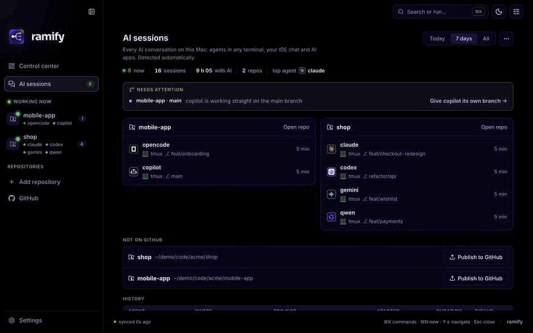
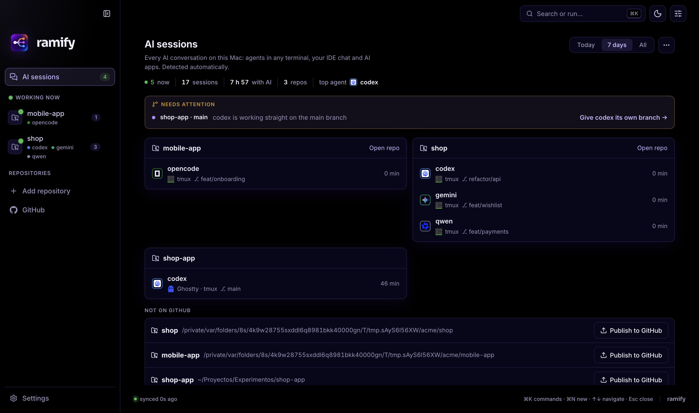
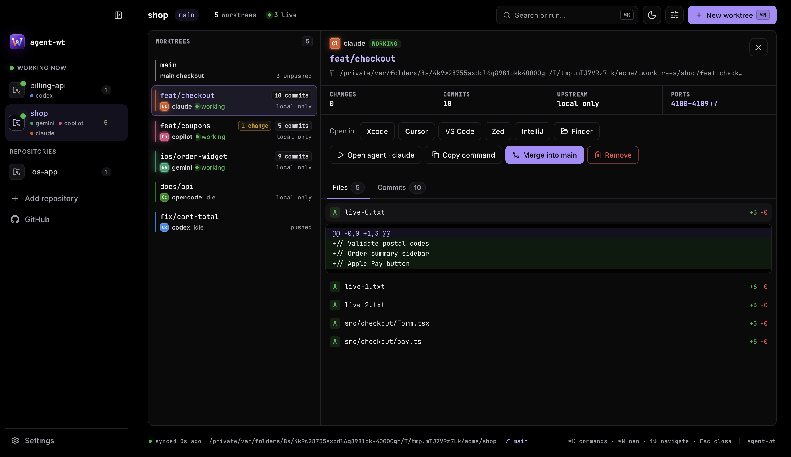
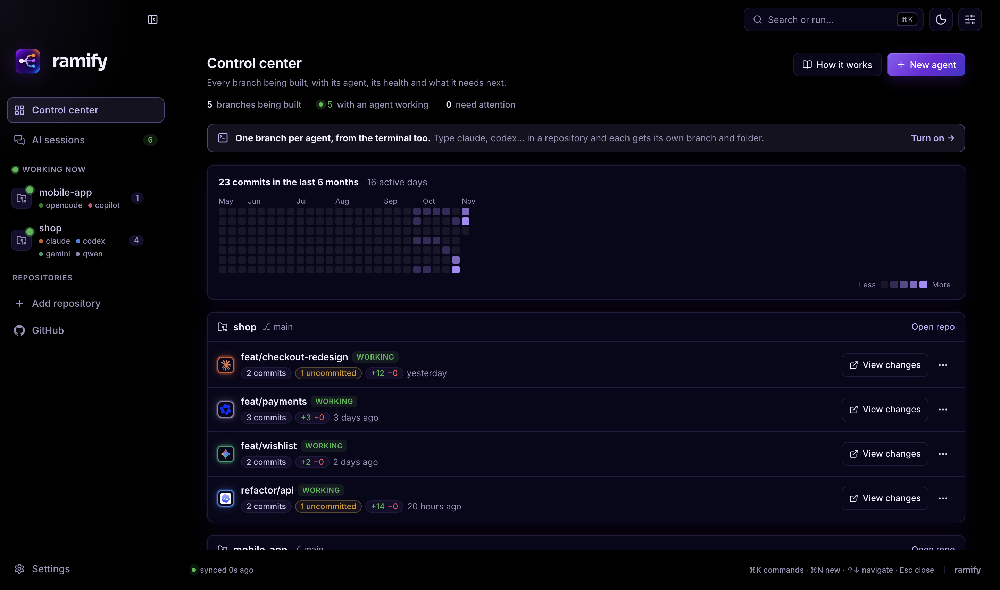
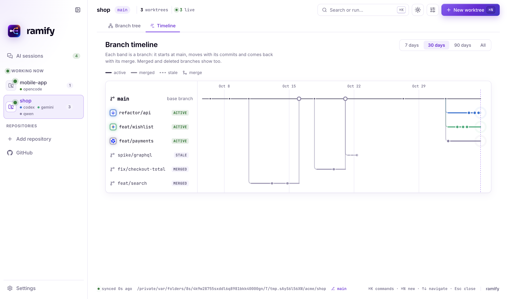
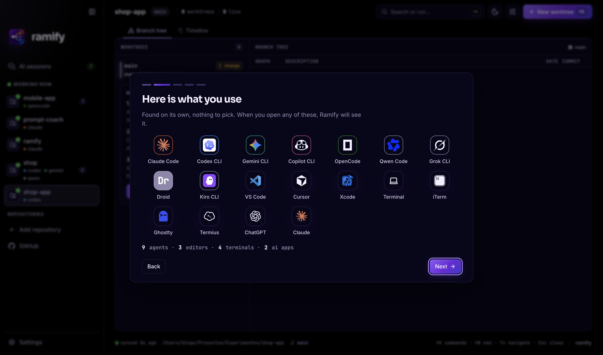
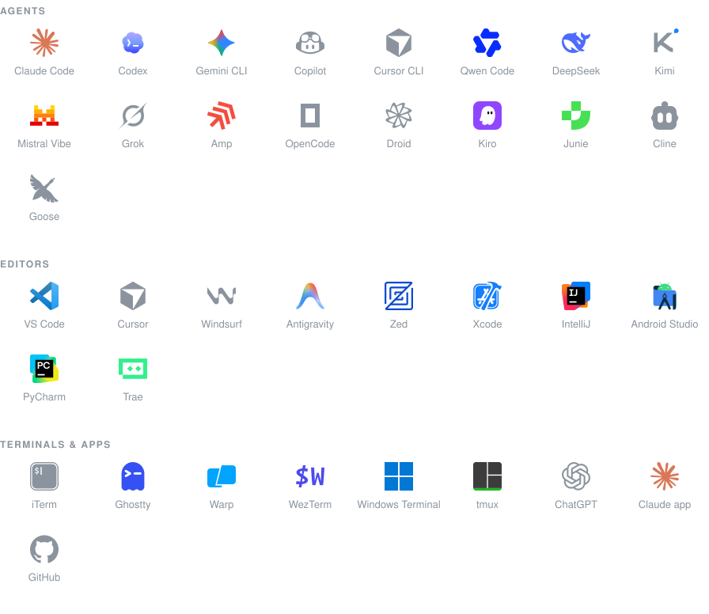
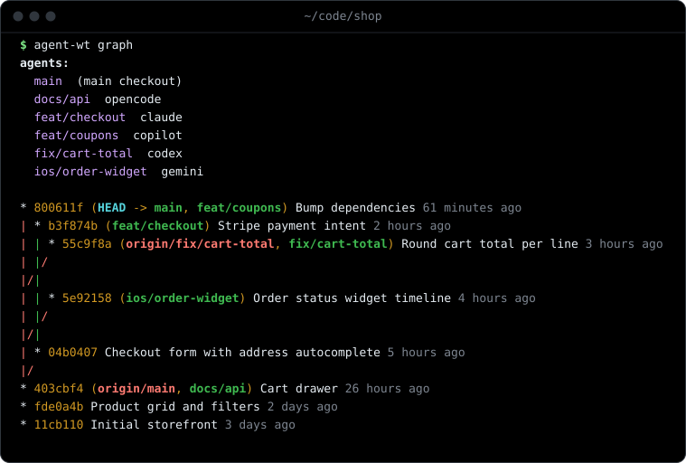
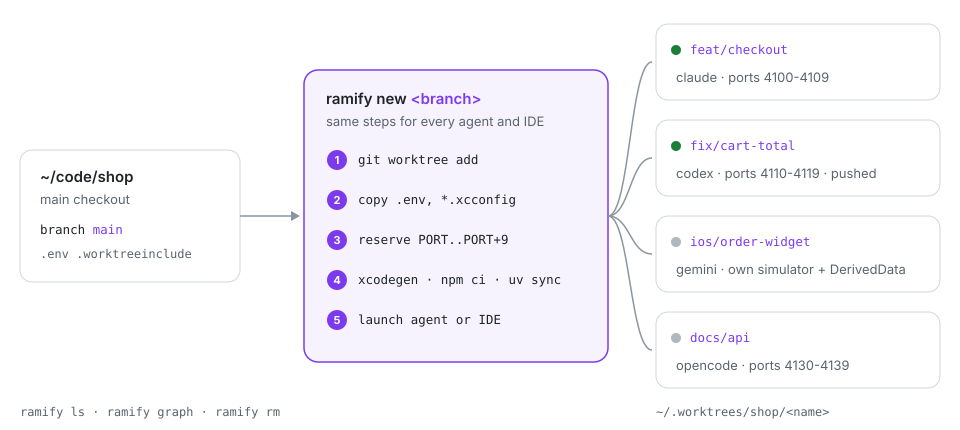

<p align="center"></p>

<h1 align="center">Ramify</h1>

<p align="center">
  <b>Todos tus agentes de IA a la vez. Sin perder nunca la pista de una rama.</b><br>
  Claude Code, Codex, Gemini, Copilot, Cursor y 35 más trabajando a la vez sobre el mismo repositorio,
  cada uno en su rama, con sus puertos y sus dependencias. Ramify los ve todos, los mantiene separados y
  te enseña qué ha cambiado cada uno.
</p>

<p align="center">
  <a href="https://github.com/diegoperezg7/ramify/releases/latest"><b>Descargar para macOS</b></a> ·
  <a href="https://github.com/diegoperezg7/ramify/releases/latest"><b>Descargar para Windows</b></a> ·
  <a href="https://github.com/diegoperezg7/ramify/releases/latest">Extensión VS Code / Cursor</a> ·
  <a href="#instalación">CLI</a>
</p>

<p align="center"><a href="README.md">English</a></p>

<p align="center"><br><sub><a href="docs/ramify-demo.mp4">Verlo en vídeo</a></sub></p>

## El problema

Los agentes de IA son rápidos y quieres más de uno. Mete dos en la misma carpeta y se pisan los ficheros.
Dale a cada uno su rama y, una semana después, nadie sabe qué rama tenía el arreglo que necesitabas, qué
agente lo hizo ni si llegó a mergearse.

**Ramify resuelve las dos cosas.** Cada tarea tiene su propio git worktree, listo para trabajar. Cada sesión
de IA del ordenador se detecta sola. Y todas las ramas están en una pantalla: qué cambió, quién lo cambió y dónde acabó.

## Qué te da

### 1. Ve cada sesión de IA, sola



Abre Claude Code en una terminal, Codex en tmux, el chat de Cursor o la app de ChatGPT: Ramify lo nota y te dice
en qué repo y rama está cada uno y si está trabajando o esperándote. Sin botones que pulsar ni plugins que
instalar en cada herramienta.

- **40 agentes CLI, 32 editores, 16 terminales y 14 apps de IA** reconocidos, con sus logos oficiales.
- Sigue cada conversación hasta el proyecto en el que trabaja de verdad, aunque el agente se abriera en tu carpeta personal.
- Historial de cada sesión (dónde, qué repo y rama, cuánto duró, su pull request), exportable a CSV o JSON.
- En la barra de menús: cuántos agentes trabajan, en ámbar si alguno te espera, y el logo y la rama de cada uno a un clic.

### 2. Una rama por agente, sin líos

Abre los agentes como siempre: con la integración de terminal activada (`ramify install shell`, o un interruptor en la app),
escribir `claude`, `codex` o `gemini` en un repo le da a ese agente su rama y su carpeta antes de empezar. Si ya estás en
una rama propia, o es un script, no cambia nada. El trabajo empezado en `main` por error pasa a su propia rama de un paso
(`ramify move`), con una copia en el stash.

Si dos agentes acaban en la misma rama, o uno empieza a cambiar `main`, Ramify te avisa (en la app y con una
notificación) y le da a ese agente su propia rama con un clic.

Cada worktree está listo para trabajar: copia los ficheros ignorados como `.env`, instala dependencias, reserva su
bloque de puertos y, en iOS, su propio simulador. Igual para todos los agentes, desde la app, el editor o la terminal.

### 3. Ve exactamente qué ha cambiado cada agente

El diff de GitHub que ya conoces: números de línea, verde lo añadido, rojo lo quitado, resumen por fichero. Abre la
rama en los editores que tienes instalados, vuelve a lanzar el agente, mergéala o quítala. Ramify se niega a borrar
nada que no esté commiteado o mergeado.



### 4. Un centro de control de las ramas en construcción

Cada rama con su agente y lo que está haciendo, sus commits, lo que falta por guardar, cuánto va por detrás de `main`, el
tamaño del cambio (con aviso a partir de ~400 líneas), su pull request y un aviso si dos ramas tocan los mismos ficheros.
Un clic para lo siguiente que necesita: traer `main`, abrir una PR en borrador, mergear o quitarla cuando ya está
mergeada. Un mapa de calor muestra los commits de los últimos seis meses. Automatismos opcionales, cada uno con su
interruptor: avisos, PR en borrador cuando un agente termina en una rama subida y limpieza de worktrees mergeados.



### 5. Todas las ramas en una línea de tiempo



Una franja por rama, desde que nace hasta su merge, con el color del agente que trabajó en ella. Las ramas
mergeadas y borradas se reconstruyen desde su commit de merge, así la historia queda completa.

### 6. Listo en un minuto



Ramify encuentra solo lo que usas, inicia sesión en GitHub con un código (solo lectura, tú eliges los repos) y
ordena tus proyectos por lo que importa: dónde hay agentes trabajando ahora, qué está en este ordenador y el resto de GitHub.

## Funciona con

<p align="center"></p>

Cualquier otro agente también funciona: Ramify lanza el comando que le digas.

## Privado por diseño

- **Todo en local, sin telemetría.** Nada de tu código, tus prompts o tus sesiones sale de tu ordenador.
- **GitHub en solo lectura.** El login usa una GitHub App con device flow: lectura de metadatos de repos y de pull
  requests, solo en los repos que tú elijas. La app no lleva ningún secreto dentro.
- **Tokens en el llavero del sistema**, cifrados, renovados cada 8 h, nunca en texto plano ni en logs y nunca
  entregados a la interfaz.
- **Endurecido.** La configuración git de un repo no puede hacer que Ramify ejecute programas; la ventana tiene una
  Content Security Policy estricta, ningún permiso del navegador y los fuses de Electron cerrados; los enlaces solo se abren por https (o a tu propio equipo).

## Antes y después

| | Sin Ramify | Con Ramify |
|---|---|---|
| Dos agentes, un repo | Se pisan los ficheros | Cada uno en su rama y su carpeta |
| Rama nueva para un agente | Copiar `.env`, instalar dependencias, buscar un puerto libre… | Un comando o un clic |
| Qué hace cada agente | Ir saltando entre pestañas de terminal | Una pantalla, en vivo, detectado solo |
| Un agente trabajando en `main` | Te enteras después | Un aviso y una rama con un clic |
| Qué cambió cada agente | `git diff` en cada carpeta | Diff estilo GitHub por rama |
| Las ramas del mes pasado | Olvidadas | Una línea de tiempo, mergeadas incluidas |

## Estado

**Versión 0.6.0.** App de escritorio para macOS (Apple silicon e Intel) y Windows (x64), extensión de VS Code / Cursor,
CLI y plugin de Claude Code, todo compilado desde este repositorio.

- **Probado:** 68 tests del núcleo, 5 tests de la interfaz en un navegador real y 72 del CLI en cada push; la batería
  del núcleo, el instalador de Windows y una prueba de humo que abre la app empaquetada también corren en Windows.
- **Aún sin firmar:** macOS y Windows avisan la primera vez (ver abajo). La firma y la notarización se activan solas
  cuando la release tenga certificados.
- **Login con GitHub:** necesita que la GitHub App de Ramify esté registrada para la build; mientras tanto, las funciones
  de GitHub usan el CLI `gh` con el que ya hayas iniciado sesión.
- **Windows:** los agentes de terminal salen sin su repositorio (Windows no deja leer la carpeta de otro proceso) y la
  app se ha verificado en CI, no a mano.

## Instalación

**App de escritorio** (macOS 12+ en Apple silicon o Intel, Windows 10+): descárgala de la
[última release](https://github.com/diegoperezg7/ramify/releases/latest). Todavía no está firmada: en macOS, la primera vez, clic derecho y *Abrir*; en Windows,
*Más información* → *Ejecutar de todas formas*. En Windows necesita [Git para Windows](https://git-scm.com/download/win).

**Extensión VS Code / Cursor**: el `.vsix` de la [última release](https://github.com/diegoperezg7/ramify/releases/latest) y luego
`code --install-extension ramify-*.vsix` (o `cursor --install-extension …`).

**CLI** (macOS y Linux; en Windows desde Git Bash):

```bash
git clone https://github.com/diegoperezg7/ramify.git
cd ramify && ./install.sh          # deja ramify en ~/.local/bin
```

Necesita `git` 2.20+ y `bash` 3.2+. Opcional: `python3` para `ramify ui`, `jq` para los hooks de Claude Code y `tmux` para `--tmux`.

**Plugin de Claude Code**: todos los worktrees que crea Claude Code (`--worktree`, sesiones en segundo plano,
`/batch`, subagentes) pasan por Ramify.

```text
/plugin marketplace add diegoperezg7/ramify
/plugin install ramify@ramify
```

Añade skills de buenas prácticas: `/ramify:nueva-rama` (empezar una tarea en su rama), `/ramify:portar-tarea` (sacar el
trabajo de main), `/ramify:preparar-pr` (al día, pequeña, commits convencionales, PR en borrador) y
`/ramify:terminar-tarea` (comprobar que está mergeada y quitar worktree y rama), además de `/ramify:status` y `/ramify:ui`.

## Empezar

```bash
cd ~/code/tu-repo
ramify new feat/login  -a claude -p "añade login con magic links"
ramify new fix/cart    -a codex  -p "corrige el redondeo del total del carrito"
ramify ls              # quién trabaja dónde, qué ha cambiado y qué está listo para mergear
```

Cuando un agente termina, revisas su diff en la app, lo mergeas y quitas el worktree con `ramify rm`.

## Preguntas frecuentes

**¿Tengo que cambiar mi forma de trabajar?** No. Sigue abriendo los agentes como siempre; Ramify los ve.
Usa `ramify new` (o *Nuevo worktree* en la app) cuando quieras una rama nueva para una tarea.

**¿Envía mi código a algún sitio?** No. Todo corre en tu ordenador. Las únicas llamadas de red van a github.com,
y solo si inicias sesión (o a través del CLI `gh` que ya usas).

**¿Qué agentes soporta?** Los 40 que reconoce se detectan y se muestran con su logo; cualquier otro comando se puede
lanzar en un worktree igualmente.

**¿Cómo detecta el chat de Cursor o VS Code?** Por la actividad del propio editor en ese proyecto. Esas sesiones se
marcan como *inferidas*, porque que el editor esté activo no prueba que haya una conversación.

**¿Y Windows?** La app, los worktrees y la detección de sesiones funcionan en Windows. Una diferencia: Windows no deja
que otro programa lea la carpeta de trabajo de un proceso, así que ahí los agentes de terminal salen sin su repo.

**¿Qué pasa con las ramas cuando termino?** Nada que no hayas pedido. `ramify prune` solo quita worktrees limpios y
mergeados, y `rm` se niega si queda algo sin commitear o sin mergear.

## Referencia

### Comandos

```bash
ramify new feat/login -a claude -p "añade login con magic links"
ramify new fix/cart -a codex -i cursor          # agente en la terminal y el worktree abierto en Cursor
ramify new ios/widget -i xcode                  # abre el .xcodeproj generado
ramify new docs/api -a opencode --tmux          # sesión tmux en segundo plano
ramify open fix/cart -a gemini                  # reabrir un worktree con otro agente

ramify ls                                       # todos los worktrees de un vistazo
ramify graph                                    # grafo de ramas con el agente de cada una
ramify ui                                       # panel web en el navegador
ramify app                                      # abre este repo en la app de escritorio
ramify rm fix/cart                              # se niega si algo se perdería
ramify prune                                    # borra los worktrees limpios ya mergeados

ramify install shell                            # los agentes abiertos en el checkout principal reciben su rama
ramify move feat/tax -a claude                  # lleva el trabajo sin commitear de main a su propia rama
```

`-f <ref>` elige la base, `--no-setup` omite la preparación y lo que va después de `--` se pasa al agente.
`-a` acepta cualquier agente (`claude`, `codex`, `gemini`, `copilot`, `cursor`, `opencode`, `qwen`, `kimi`, `aider`…)
o cualquier otro comando; `-p` se pasa como lo espera cada agente, o se copia al portapapeles.
`-i` abre un editor: `xcode`, `cursor`, `code`, `zed`, `idea` o cualquier app por su nombre (`-i "Android Studio"`).

<p align="center"></p>

### Cómo se prepara un worktree

<p align="center"></p>

1. **Worktree** en `~/.worktrees/<repo>/<nombre>`, fuera del repo, para que los editores y los watchers del checkout principal no lo indexen.
2. **Ficheros ignorados** de `.worktreeinclude` (sintaxis gitignore, el mismo fichero que lee Claude Code), como `.env`.
3. **Puertos**: un bloque de 10 (`PORT` a `PORT+9`) a partir del 4100.
4. **Preparación**: `.worktree/setup.sh` si el proyecto lo tiene; si no, `xcodegen generate`, `pnpm`/`yarn`/`bun`/`npm ci` o `uv sync`.
5. **Arranque**: el agente dentro del worktree con `.worktree.env` exportado, y/o tu editor.

### Dentro de un worktree

Cada worktree tiene un `.worktree.env`, excluido de git, que se exporta al agente:

| Variable       | Ejemplo                                  |
|----------------|------------------------------------------|
| `WT_NAME`      | `feat-login`                             |
| `WT_BRANCH`    | `feat/login`                             |
| `WT_PATH`      | `~/.worktrees/shop/feat-login`           |
| `WT_MAIN`      | `~/code/shop`                            |
| `WT_AGENT`     | `claude`                                 |
| `PORT`         | `4100` (usa del `4100` al `4109`)        |
| `DERIVED_DATA` | `~/.worktrees/shop/.derived-data/feat-login` |

Los agentes conocen las reglas por un bloque corto en sus instrucciones globales:

```bash
ramify install instructions
```

Añade [`snippets/agent-instructions.md`](snippets/agent-instructions.md) una sola vez a cada agente
instalado: `~/.claude/CLAUDE.md`, `~/.codex/AGENTS.md`, `~/.gemini/GEMINI.md`,
`~/.config/opencode/AGENTS.md`, `~/.copilot/copilot-instructions.md` y `~/.config/amp/AGENTS.md`.
No escribe nada en tus repositorios.

### Preparación por proyecto

```
tu-repo/
├── .worktreeinclude          # ficheros ignorados que se copian: .env, Local.xcconfig ...
└── .worktree/
    ├── setup.sh              # se ejecuta en cada worktree nuevo, con .worktree.env exportado
    └── teardown.sh           # se ejecuta antes de borrar el worktree
```

Los dos scripts son opcionales y pueden quedarse sin versionar: Ramify también los busca en el
checkout principal. Ejemplos en [`examples/`](examples):

- [`ios-xcodegen`](examples/ios-xcodegen): `xcodegen generate` y un simulador propio por worktree
  (`SIM_UDID`), que se borra con él.
- [`web`](examples/web): `npm ci` y un `.env.local` que fija Vite y la API a los puertos del worktree.

### Integración con Claude Code

```bash
ramify install claude-hooks
```

Registra Ramify como hooks `WorktreeCreate` y `WorktreeRemove` de Claude Code (con copia de
`~/.claude/settings.json`). Desde entonces `claude --worktree`, las sesiones en segundo plano,
`/batch`, los workflows y los subagentes con `isolation: worktree` crean sus worktrees con Ramify,
con la misma estructura, puertos y preparación que el resto de agentes. Claude Code conserva los
worktrees de los subagentes al terminar, así que conviene lanzar `ramify prune` de vez en cuando.

### Seguridad

- `rm` se niega si hay cambios sin commitear o commits que no están ni mergeados ni subidos.
- `rm --force` descarta los cambios sin commitear pero **nunca borra una rama con commits sin
  mergear**: se va el worktree y se queda la rama.
- `prune` solo borra worktrees limpios y ya mergeados.
- El checkout principal no se toca, salvo una línea en `.git/info/exclude` (`/.worktree.env`).

### Configuración

| Variable          | Por defecto    |
|-------------------|----------------|
| `RAMIFY_ROOT`     | `~/.worktrees` |
| `RAMIFY_PORT_MIN` | `4100`         |
| `RAMIFY_PORT_MAX` | `4990`         |
| `NO_COLOR`        | sin definir    |

### Tests

```bash
bash tests/run.sh             # CLI, contra repos desechables con agentes simulados (macOS y Linux)
npm run test:core             # motor, detección de sesiones, login de GitHub, validación del IPC, línea de tiempo (también en Windows)
npm run test:e2e -w packages/core   # la UI real en Chromium: navegador, editor y nada cortado de 390 a 1920 px
```

Todos corren en la CI; la batería del motor y el instalador de Windows también en Windows.

### Contribuir

Issues y pull requests son bienvenidos. Antes de abrir una PR pasa las tres baterías de tests de arriba; si cambias
`ui/web`, recompílalo con `npm run build:web` y sincroniza el plugin con `scripts/sync-plugin.sh` (CI lo comprueba).

## Licencia

[MIT](LICENSE). Los logos de las herramientas con las que trabaja Ramify son marcas de sus dueños y solo se muestran
para identificarlas. Los iconos vienen de [LobeHub Icons](https://github.com/lobehub/lobe-icons) (MIT),
[Simple Icons](https://simpleicons.org) (CC0) y [Devicon](https://devicon.dev) (MIT); `node scripts/brand-icons.mjs` los regenera.
