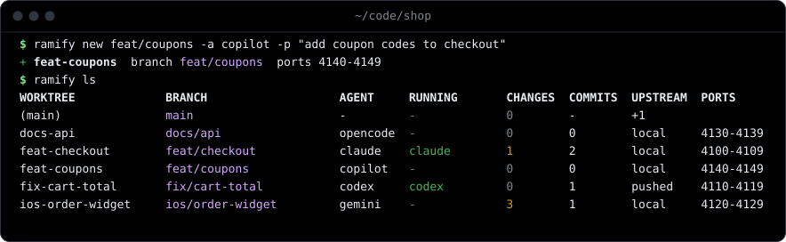
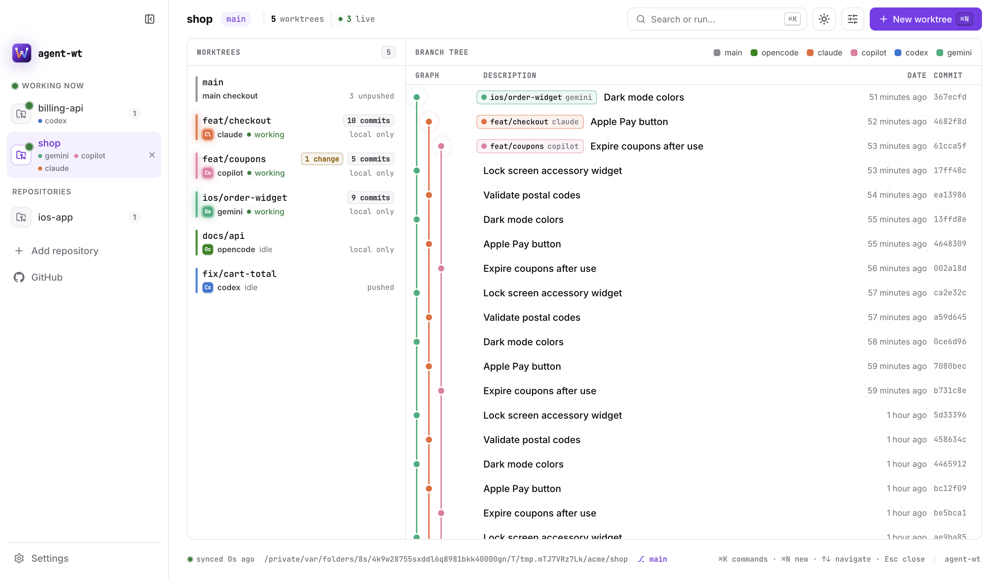
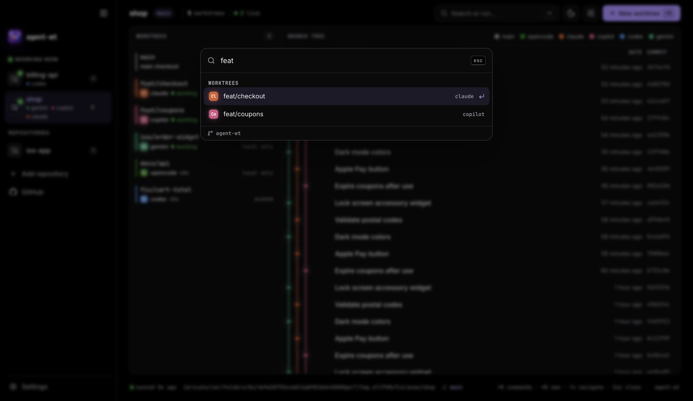

<p align="center"></p>

<h1 align="center">agent-wt</h1>

<p align="center">
  <b>One git worktree per task. Any coding agent. Any IDE.</b><br>
  Run Claude Code, Codex, Gemini, Copilot, Cursor, OpenCode or Aider side by side on the same repository,<br>
  each on its own branch, with its own ports, dependencies and simulator.
</p>

<p align="center">
  <a href="https://github.com/diegoperezg7/agent-wt/actions/workflows/ci.yml"></a>
  
  
  <a href="LICENSE"></a>
  <a href="README.es.md"></a>
</p>

<p align="center"></p>

## Why

Two agents in one checkout overwrite each other's files. `git worktree` fixes that, but a bare
worktree is not ready to work in: no `.env`, no `node_modules`, no generated Xcode project, the same
dev-server port as every other copy, and one shared simulator. agent-wt does that setup in one
command, the same way for every agent, so you can open five terminals and let five agents work.

## How it works

<p align="center"></p>

1. **Worktree**: `~/.worktrees/<repo>/<name>`, outside the repo, so IDEs, test runners and file
   watchers in the main checkout never index it. It branches from your current `HEAD` by default.
2. **Ignored files**: files listed in `.worktreeinclude` (gitignore syntax, the same file Claude
   Code reads) are copied over, such as `.env` or `Local.xcconfig`.
3. **Ports**: each worktree gets its own block of 10 ports (`PORT` to `PORT+9`) starting at 4100.
4. **Setup**: `.worktree/setup.sh` if the project has one, otherwise auto-detected:
   `xcodegen generate`, `pnpm`/`yarn`/`bun`/`npm ci`, `uv sync`.
5. **Launch**: the agent in the worktree with `.worktree.env` exported, and/or your IDE.

## Install

```bash
git clone https://github.com/diegoperezg7/agent-wt.git
cd agent-wt && ./install.sh          # symlinks agent-wt into ~/.local/bin
```

Requires `git` 2.31+ and `bash` 3.2+ (macOS default works). `python3` for the dashboard, `jq` for the Claude Code hooks, `tmux` for `--tmux`.

## Usage

```bash
agent-wt new feat/login -a claude -p "add login with magic links"
agent-wt new fix/cart -a codex -i cursor          # agent in the terminal, worktree open in Cursor
agent-wt new ios/widget -i xcode                  # opens the generated .xcodeproj
agent-wt new docs/api -a opencode --tmux          # detached tmux session
agent-wt open fix/cart -a gemini                  # reopen an existing worktree with another agent

agent-wt ls                                       # every worktree at a glance
agent-wt graph                                    # branch graph with the agent on each branch
agent-wt ui                                       # live web dashboard
agent-wt app                                      # open this repository in the desktop app
agent-wt rm fix/cart                              # refuses if anything would be lost
agent-wt prune                                    # remove clean worktrees that are already merged
```

`-f <ref>` picks the base, `--no-setup` skips setup, and anything after `--` is passed to the agent.

### Agents

| `-a`       | Runs           | `-p` prompt is passed as |
|------------|----------------|--------------------------|
| `claude`   | `claude`       | first argument           |
| `codex`    | `codex`        | first argument           |
| `gemini`   | `gemini`       | `-i <prompt>`            |
| `copilot`  | `copilot`      | `-i <prompt>`            |
| `cursor`   | `cursor-agent` | first argument           |
| `opencode` | `opencode`     | clipboard (no flag)      |
| `aider`    | `aider`        | clipboard (no flag)      |
| `amp`      | `amp`          | clipboard (no flag)      |
| anything else | that command | clipboard             |

`ls` also shows which agent process is **running** inside each worktree right now.

### IDEs

`-i xcode` opens the project's `.xcworkspace` or `.xcodeproj`. `cursor`, `code`, `zed` and `idea`
are mapped to their apps, and any other value is opened as a macOS app name (`-i "Android Studio"`)
or as a command on Linux.

## See every branch

<p align="center"></p>

`agent-wt graph` lists which agent works on which branch and draws the commit graph of all of them,
so you can see what each agent did, what is pushed and what is ready to merge.

## Apps

The same interface runs in four places. All of them read the repository live, every few seconds.

<p align="center"></p>

| | What you get |
|---|---|
| **Desktop app** (macOS) | Lives in the menu bar with the number of agents working, puts it on the Dock icon and notifies you when an agent finishes (click to review its changes). `agent-wt app` opens the repository you are in. Every repository in one window. Repositories where an agent is running right now appear by themselves under *Working now*; your GitHub repositories are one click away (add the local clone or clone it). Create a worktree, pick the agent and it opens in Terminal, iTerm or Ghostty. ⌘K command palette, ⌘N new worktree, ↑/↓ to move. |
| **VS Code / Cursor extension** | The dashboard as an editor tab (`agent-wt: Open dashboard`, ⌘⌥W), agents launched in the integrated terminal, a status bar counter of agents working. |
| **Claude Code plugin** | Every Claude Code worktree (`--worktree`, background sessions, `/batch`, subagents) is created by agent-wt, plus `/agent-wt:status` and `/agent-wt:ui`. |
| **Browser** (`agent-wt ui`) | Single repository dashboard from the terminal: 127.0.0.1 only, one-time token. |

<p align="center">
  
  
</p>

Light and dark mode (or follow the system), English and Spanish, comfortable or compact density, and a layout that
goes from three columns on a wide screen to a slide-over inspector and a phone-sized single column.

### Install

```bash
# desktop app
npm ci && npm run build:desktop        # → apps/desktop/release/agent-wt-<version>-arm64.dmg

# VS Code / Cursor
npm ci && npm run build:vscode         # → apps/vscode/agent-wt.vsix
cursor --install-extension apps/vscode/agent-wt.vsix   # or: code --install-extension ...
```

```text
# Claude Code plugin (use either the plugin or `agent-wt install claude-hooks`, not both)
/plugin marketplace add diegoperezg7/agent-wt
/plugin install agent-wt@agent-wt
```

The desktop app is not signed: the first time, right-click it and choose *Open*. GitHub integration uses the
`gh` CLI you are already signed in to. The browser dashboard needs `python3` and uses the prebuilt `ui/dist`.

### How it is built

`packages/core` is the engine in TypeScript (state, diffs, merge, create, project detection, GitHub). The desktop
app (Electron) and the extension share it and bundle the `agent-wt` script, so they work without the CLI installed.
`ui/web` is one React app that talks to whichever host it runs in: Electron IPC, VS Code webview messages or HTTP.

## Inside a worktree


Every worktree has a `.worktree.env`, excluded from git, that is exported into the agent:

| Variable       | Example                                  |
|----------------|------------------------------------------|
| `WT_NAME`      | `feat-login`                             |
| `WT_BRANCH`    | `feat/login`                             |
| `WT_PATH`      | `~/.worktrees/shop/feat-login`           |
| `WT_MAIN`      | `~/code/shop`                            |
| `WT_AGENT`     | `claude`                                 |
| `PORT`         | `4100` (use `4100` to `4109`)            |
| `DERIVED_DATA` | `~/.worktrees/shop/.derived-data/feat-login` |

Agents learn the rules from a short block in their global instructions:

```bash
agent-wt install instructions
```

It adds [`snippets/agent-instructions.md`](snippets/agent-instructions.md) once to every agent
that is installed: `~/.claude/CLAUDE.md`, `~/.codex/AGENTS.md`, `~/.gemini/GEMINI.md`,
`~/.config/opencode/AGENTS.md`, `~/.copilot/copilot-instructions.md` and `~/.config/amp/AGENTS.md`.
Nothing is written into your repositories.

## Project setup

```
your-repo/
├── .worktreeinclude          # ignored files to copy: .env, Local.xcconfig ...
└── .worktree/
    ├── setup.sh              # runs in each new worktree, with .worktree.env exported
    └── teardown.sh           # runs before the worktree is removed
```

Both scripts are optional and can stay untracked: agent-wt also looks for them in the main checkout.
See [`examples/`](examples):

- [`ios-xcodegen`](examples/ios-xcodegen): `xcodegen generate` plus a dedicated simulator per
  worktree (`SIM_UDID`), deleted on removal.
- [`web`](examples/web): `npm ci` and a `.env.local` that pins Vite and the API to the worktree's ports.

## Claude Code integration

```bash
agent-wt install claude-hooks
```

This registers agent-wt as Claude Code's `WorktreeCreate` and `WorktreeRemove` hooks (with a backup
of `~/.claude/settings.json`). From then on `claude --worktree`, background sessions, `/batch`,
workflows and subagents with `isolation: worktree` all create their worktrees through agent-wt,
with the same layout, ports and setup as every other agent. Claude Code keeps subagent worktrees
after they finish, so run `agent-wt prune` now and then.

## Safety

- `rm` refuses when there are uncommitted changes, or commits that are neither merged nor pushed.
- `rm --force` discards uncommitted changes but **never deletes a branch with unmerged commits**:
  the worktree goes, the branch stays.
- `prune` only removes worktrees that are clean and already merged.
- The main checkout is never touched, except for one line in `.git/info/exclude` (`/.worktree.env`).

## Configuration

| Variable            | Default        |
|---------------------|----------------|
| `AGENT_WT_ROOT`     | `~/.worktrees` |
| `AGENT_WT_PORT_MIN` | `4100`         |
| `AGENT_WT_PORT_MAX` | `4990`         |
| `NO_COLOR`          | unset          |

## Tests

```bash
bash tests/run.sh             # CLI, against throwaway repositories with stub agents (macOS and Linux)
npm run test:core             # engine
npm run test:e2e -w packages/core   # the real UI in Chromium: browser host, editor host, no clipping 390–1920px
```

All of them run in CI.

## License

[MIT](LICENSE)
