<p align="center"></p>

<h1 align="center">Ramify</h1>

<p align="center">
  <b>Work with several AI assistants at once, without them stepping on each other.</b><br>
  Claude Code, Codex, Gemini, Copilot, Cursor and 35 more can build different parts of your project at the same time.
  Ramify gives each one its own space, shows you who is doing what right now, and lets you bring each piece of work
  into your project with one click when it is ready.
</p>

<p align="center">
  <a href="https://github.com/diegoperezg7/ramify/releases/latest"><b>Download for macOS</b></a> ·
  <a href="https://github.com/diegoperezg7/ramify/releases/latest"><b>Download for Windows</b></a> ·
  <a href="#for-developers">CLI, editor extension and Claude Code plugin</a>
</p>

<p align="center">
  <a href="https://github.com/diegoperezg7/ramify/actions/workflows/ci.yml"></a>
  
  
  <a href="LICENSE"></a>
  <a href="README.es.md"></a>
</p>

<p align="center"><a href="docs/ramify-demo.mp4">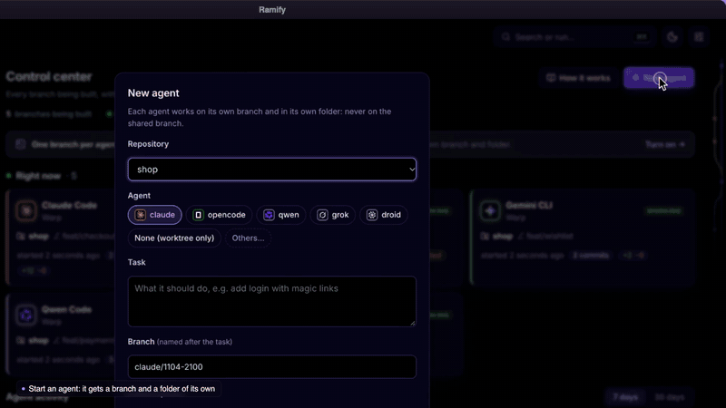</a></p>

<p align="center"><sub><b><a href="docs/ramify-demo.mp4">▶ Watch the full demo (55 s)</a></b>: agents working now, a new agent and its terminal, agent hours, any day in detail, the branches and a merge in one click</sub></p>

## In plain words

AI assistants that write code are fast, and once you try two at a time you do not want to go back. The catch:
put two of them in the same project and they overwrite each other's work. Give each one a separate copy and,
a week later, nobody remembers which copy had the change you needed.

**Ramify is the desk organiser for your AI team.**

- **Each assistant gets its own desk.** A separate copy of your project (a *branch*), set up and ready, so
  nobody touches anybody else's work. It happens by itself, also when you open an assistant from the terminal.
- **You see the whole office at a glance.** Who is working right now, on what, for how long, and what they have
  changed. It finds them on its own: nothing to configure in each tool.
- **You decide what goes in.** When a piece of work is ready, you look at exactly what changed and bring it
  into your project with one click. If something clashes, Ramify says why in plain words and changes nothing.

Everything stays on your computer.

## Who it is for

- **You build with AI.** You use Claude Code, Codex, Cursor or similar to make apps, sites or tools, and want
  several working at once without losing track.
- **You are a developer.** You already run agents in parallel and want branches, ports and dependencies handled
  for you, plus one screen with every branch being built.
- **You lead a small team.** You want to see where the AI work is going, what is ready, and what needs a look.

## Get started in three steps

**1. Install it.** Download the app for [macOS or Windows](https://github.com/diegoperezg7/ramify/releases/latest).
On a Mac, drag Ramify into Applications.

<p align="center">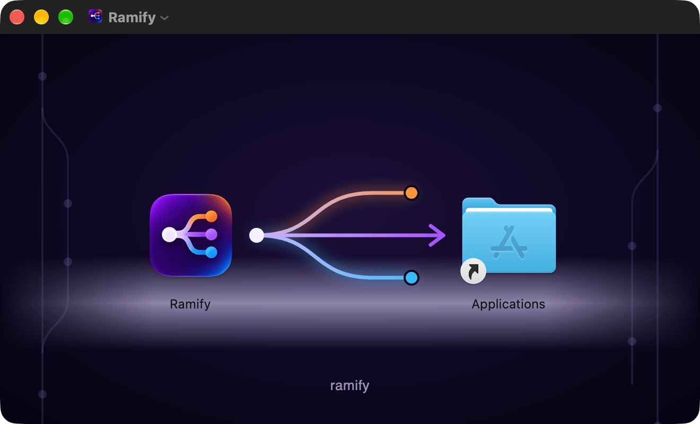</p>

**2. Let it set up this computer.** The first time, Ramify shows the AI tools it found on this computer and offers
to set everything up with one click: from then on every assistant works on a branch of its own, also the ones you
start from a terminal. You can undo it in Settings.

<p align="center"><picture><source media="(prefers-color-scheme: dark)" srcset="docs/screenshots/app-setup-dark.png">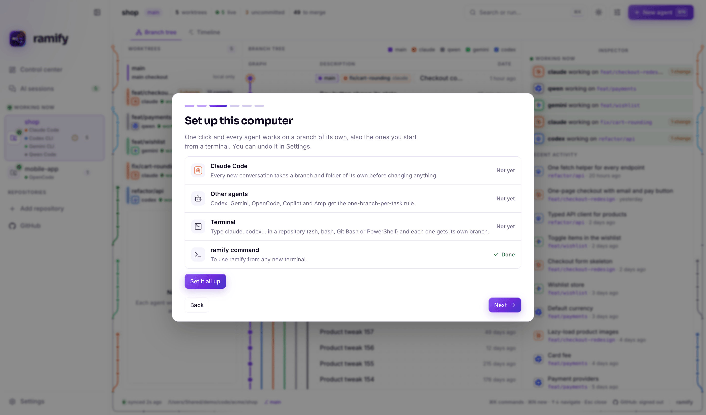</picture></p>

**3. Work as you always do.** Open your assistants the way you already do. Ramify notices them, gives each one its
own space and shows them in the control center. When one finishes, review its changes and bring them in.

## What you can do

### See who is working right now

<picture><source media="(prefers-color-scheme: dark)" srcset="docs/screenshots/app-control-dark.png">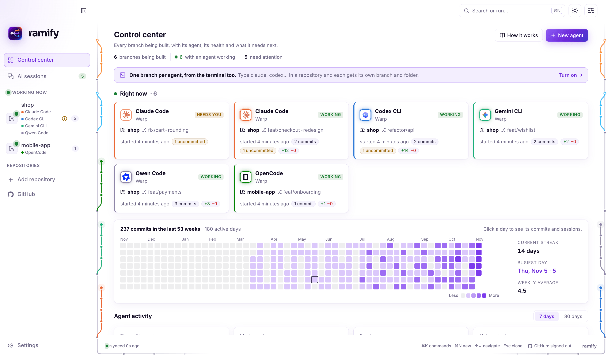</picture>

One card per assistant at work: which one, in which project and branch, since when, and what it has changed so far.
The one that stopped to ask you something says so. With nobody working, it shows where and with which assistants you
worked last. A warning appears if one starts changing the main version of your project directly, with a button to
move it to its own branch.

### See how much, and when, your assistants work

<picture><source media="(prefers-color-scheme: dark)" srcset="docs/screenshots/app-activity-dark.png">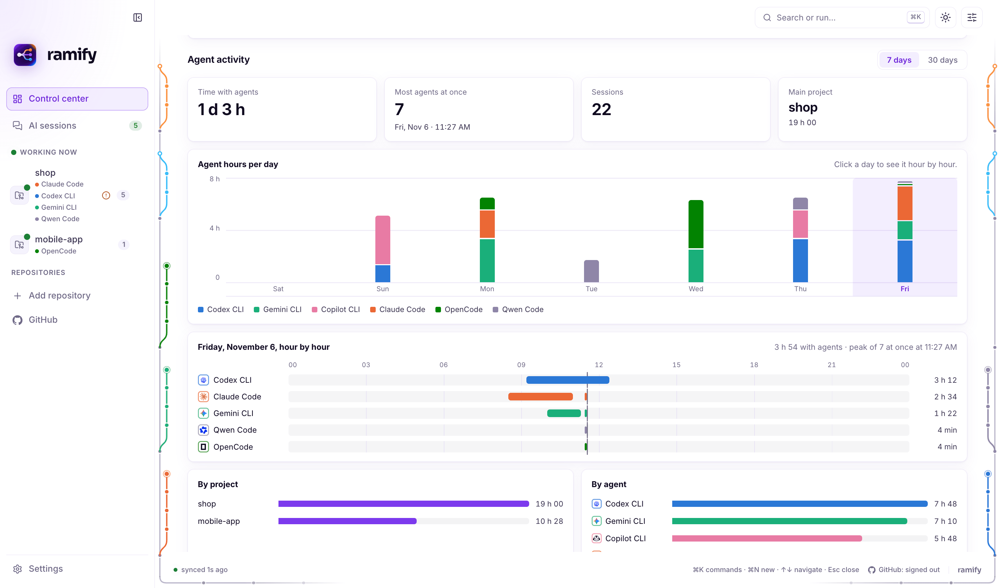</picture>

The week or the month in four figures (time with agents, most at once, sessions, main project), hours per day for
each assistant, and any day hour by hour: who worked when, and how many were working at the same time.

### Your work history at a glance, any day in detail

<picture><source media="(prefers-color-scheme: dark)" srcset="docs/screenshots/app-heatmap-dark.png">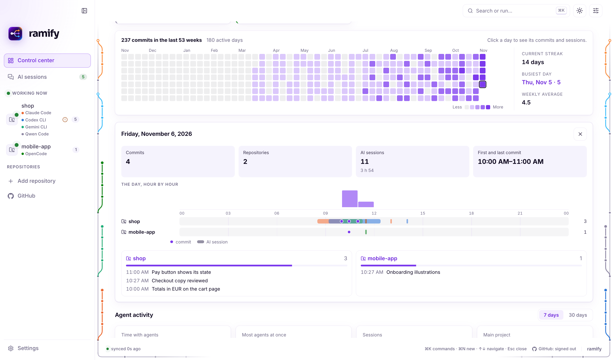</picture>

A year of work as a grid of squares, your current streak and your busiest day. Click any square to open that day:
how much was saved and when, one lane per project with its commits and the assistants that worked on it, and what
was saved in each one.

### Every AI conversation on your computer

<picture><source media="(prefers-color-scheme: dark)" srcset="docs/screenshots/app-sessions-dark.png">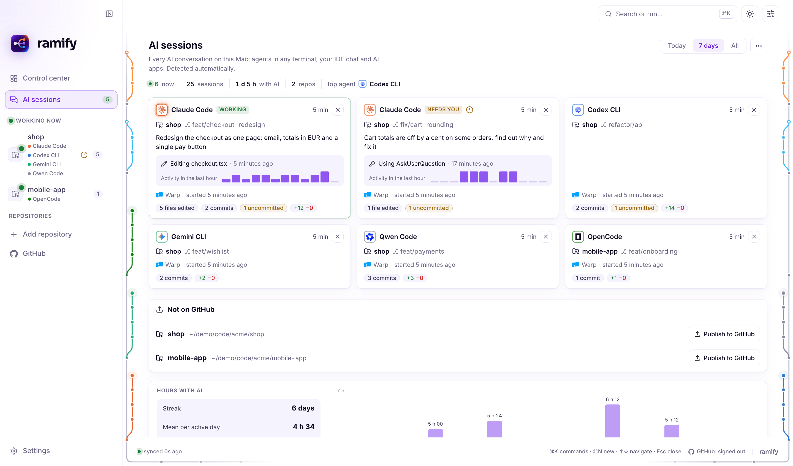</picture>

Assistants in any terminal, the chat in your editor and the AI desktop apps, found on their own. One card per
conversation: what it was asked to do, its last step, how busy it was in the last hour, the files it edited and what
its branch holds. Inside each one, the agents it started and the branch each works on: Claude Code subagents mid-task,
agent-team teammates in their own pane, worktrees a subagent made, and the Codex threads of the ChatGPT app. Below,
the hours with AI per day, the projects of the week and a history of every session grouped by day, exportable to a
spreadsheet.

### Know when an assistant needs you

The menu bar counts, in amber, the assistants that need you: one waiting for an answer, two working on the same
branch, one changing the main version directly, or one that finished on a branch ready to bring in. In violet, the
ones at work; open it to see what each one is doing. The Dock shows the same count, the sidebar flags the projects
with something to look at, and a notification tells you once when a branch is ready (Ramify asks first, and you can
turn it off in Settings).

### See exactly what each assistant changed

https://github.com/user-attachments/assets/6fb28701-b117-49b2-a899-73d64cae7ea8

Every branch with its assistant, and its changes line by line as on GitHub: green for added, red for removed.
Open it in the editors you have installed, start the assistant again, bring it in, or remove it. Ramify never
deletes work that has not been saved or brought in.

<picture><source media="(prefers-color-scheme: dark)" srcset="docs/screenshots/app-branches-dark.png">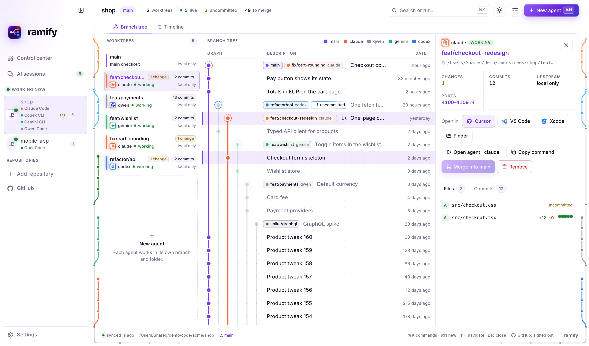</picture>

The main version stands out in violet in the tree, the list and the detail. Signed in with GitHub, each branch also
shows its open pull request.

### Bring the work in with one click

https://github.com/user-attachments/assets/70585f1f-0d82-400b-bede-42561499f0c9

When a piece of work is ready, one click brings it into your project and a short message confirms it. If it
clashes with something else, a window explains what happened, which files clash and what to do. Nothing is changed.

### Every branch on one timeline

<picture><source media="(prefers-color-scheme: dark)" srcset="docs/screenshots/app-timeline-dark.png">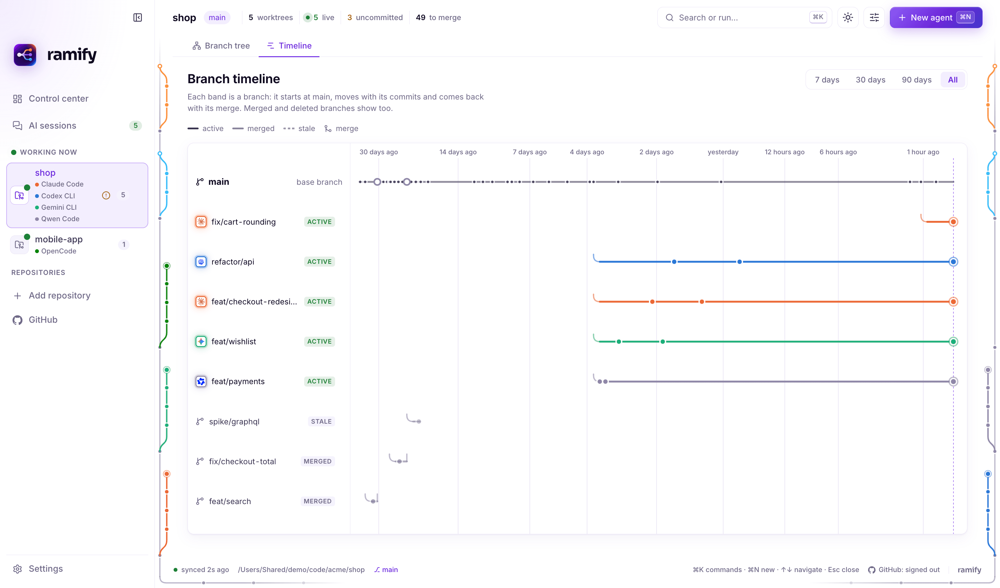</picture>

One band per branch, from where it started to where it was brought in, in the colour of the assistant that worked
on it. Branches that were finished and deleted are still there, so the story stays complete.

### Start an assistant with a click

<picture><source media="(prefers-color-scheme: dark)" srcset="docs/screenshots/app-new-agent-dark.png">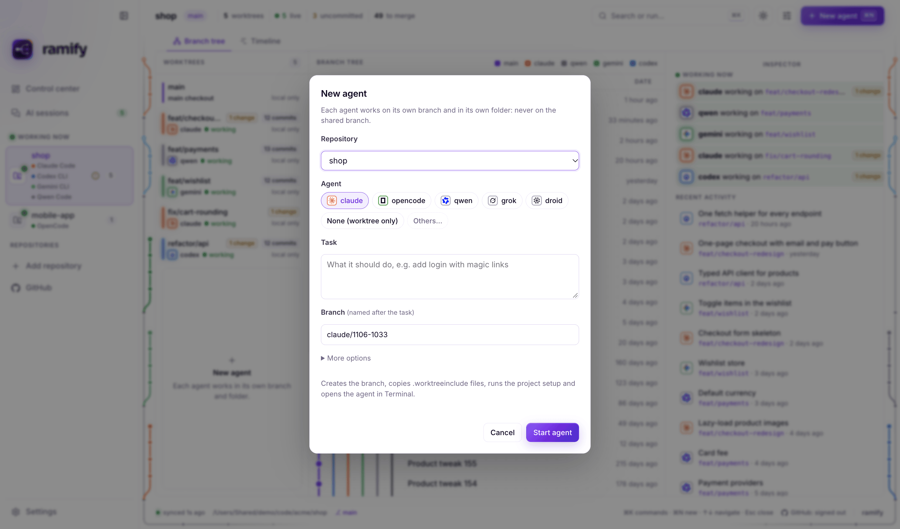</picture>

Pick the assistant by its logo (the ones installed on this computer come first, every other one is a click away),
say what it should do, and Ramify creates its branch and opens it in your terminal.

### Settings you can see at a glance

<picture><source media="(prefers-color-scheme: dark)" srcset="docs/screenshots/app-settings-dark.png">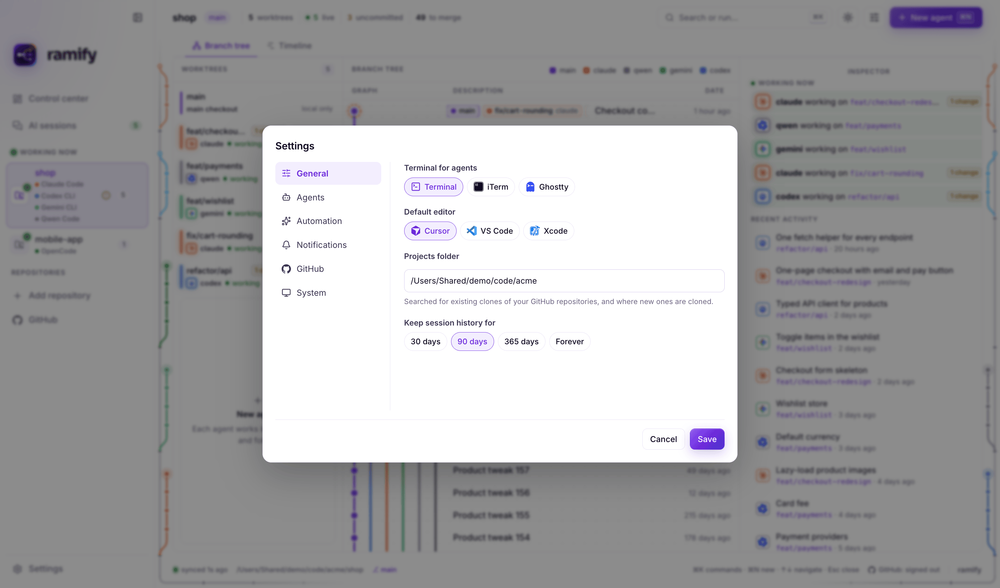</picture>

Settings are grouped in tabs on the side: General, Agents, Automation, Notifications, GitHub and System. The terminal,
the editor and the default assistant are chosen by their logos instead of from a long list. GitHub sign-in is in its
own tab and in the status bar, any time after the introduction.

<picture><source media="(prefers-color-scheme: dark)" srcset="docs/screenshots/app-settings-agents-dark.png">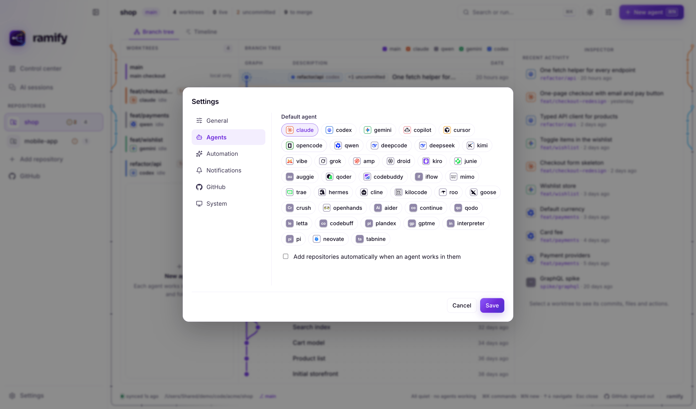</picture>

### Light or dark, as your system

 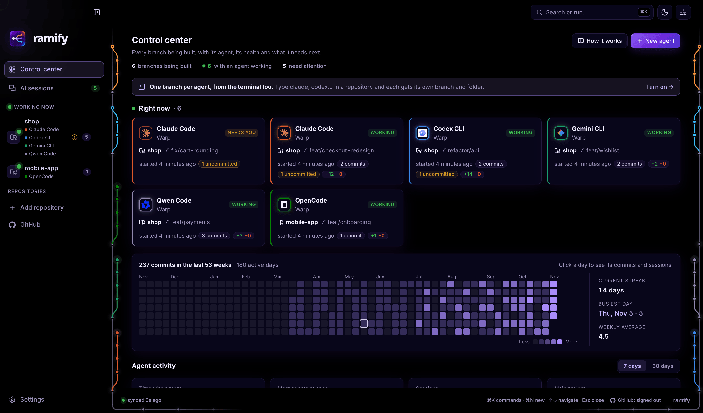

## Words you will see

| Word | What it means |
|---|---|
| **Agent** or **assistant** | An AI that writes code for you: Claude Code, Codex, Gemini, Copilot, Cursor… |
| **Branch** | A separate version of your project where one piece of work is done without touching the rest. |
| **Worktree** | The folder where a branch lives, so each agent has its own copy to work in. |
| **main** | The main version of your project, the one the finished work goes into. |
| **Merge** | Bringing the work of a branch into main. |
| **Commit** | A saved step of work, with a short description of what changed. |

## Works with

<p align="center">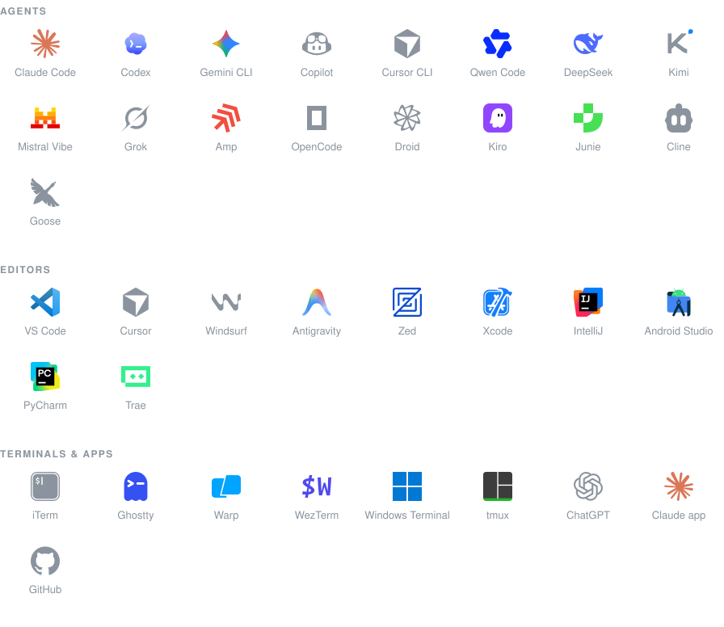</p>

Any other agent works too: Ramify launches whatever command you give it.

## Private by design

- **Local-first, no telemetry.** Nothing about your code, prompts or sessions leaves your computer.
- **GitHub, read-only.** Sign-in uses a GitHub App with the device flow: read access to repository metadata
  and pull requests, only on the repositories you choose. No secret ships with the app.
- **Tokens in the system keychain**, encrypted, refreshed every 8 hours, never written in plain text or logs,
  never handed to the interface.
- **Hardened.** A repository's own git settings cannot make Ramify run programs; the desktop window has a strict
  Content Security Policy, no browser permissions and locked Electron fuses; links open only over https (or to your own machine).

## Before and after

| | Without Ramify | With Ramify |
|---|---|---|
| Two agents, one repository | They overwrite each other's files | Each on its own branch and folder |
| A new branch for an agent | Copy `.env`, install dependencies, pick a free port… | One command or one click |
| Which agent is doing what | Switch between terminal tabs | One screen, live, detected by itself |
| An agent working on `main` | You find out later | A warning and a one-click branch |
| An agent waiting for an answer | You find it when you switch tabs | An amber count in the menu bar |
| What each agent changed | `git diff` in each folder | GitHub-style diff per branch |
| Last month's branches | Gone from memory | A timeline, merged ones included |

## Questions

**Do I need to know git?** No. Ramify creates and names the branches, keeps each assistant in its own, and brings
the work in when you click. The words you will see are explained [above](#words-you-will-see).

**Does it work with the AI tools I already use?** Very likely: it recognises 40 assistants, 32 editors, 16
terminals and 14 AI apps, and any other command can run in its own branch all the same.

**What happens if two assistants change the same file?** Ramify warns you while they work (the branch shows a
"touches the same files" warning). When you bring the second one in, if the changes really clash, it stops,
changes nothing and explains what to do.

**Do I have to change how I work?** No. Keep opening agents the way you do now; Ramify notices them.
Use `ramify new` (or the app's *New agent*) when you want a fresh branch for a task.

**Does it send my code anywhere?** No. Everything runs on your computer. The only network calls are to
github.com: the app looking for a new version of itself (you can turn it off in Settings), and GitHub features only
if you sign in (or through the `gh` CLI you already use).

**Which agents does it support?** The 40 it recognises are detected and shown with their logos; any other
command can be launched in a worktree all the same.

**How does it detect the chat inside Cursor or VS Code?** From the editor's own workspace activity. Those
sessions are marked *inferred*, because an editor being active is not proof of a conversation.

**Windows?** The app, the worktrees and session detection work on Windows. One difference: Windows does not let
another program read a process's working folder, so terminal agents there are shown without their repository.

**What happens to the branches when I am done?** Nothing you did not ask for. `ramify prune` removes only clean,
merged worktrees, and `rm` refuses when there is anything uncommitted or unmerged.

## For developers

Everything above is the desktop app. Ramify is also a command line tool, a VS Code / Cursor extension and a Claude
Code plugin, all built from this repository. This part is for people who want to install those, build from source
or know how it works inside.

## Status

**Version 0.8.0.** Desktop app for macOS (Apple silicon) and Windows (x64), VS Code / Cursor extension,
CLI and Claude Code plugin, all built from this repository.

- **Tested:** 131 core tests, 10 end-to-end UI tests in a real browser and 103 CLI tests run on every push; the core
  suite, the Windows installer and a smoke test that opens the packaged app also run on Windows.
- **Downloads:** every version is in [Releases](https://github.com/diegoperezg7/ramify/releases). To build it yourself:
  `npm ci && npm run build:desktop` (the installers land in `apps/desktop/release/`).
- **Signing:** the macOS app is signed with a Developer ID and notarized. The Windows installer is not signed yet and
  shows a warning the first time (see below).
- **GitHub sign-in** uses the [Ramify Desktop](https://github.com/apps/ramify-desktop) GitHub App; without signing in,
  GitHub features use the `gh` CLI you are signed in to.
- **Windows:** terminal agents are listed without their repository (Windows does not expose another process's folder),
  and the app has been verified in CI rather than by hand.

## Install

**Desktop app** (macOS 12+ on Apple silicon, Windows 10+): download it from the
[latest release](https://github.com/diegoperezg7/ramify/releases/latest). On macOS it opens like any other app. On Windows,
which is not signed yet, choose *More info* → *Run anyway*. Windows needs [Git for Windows](https://git-scm.com/download/win).

**Updates** (from 0.7.6): when a new release is out, the app says so in a corner with a *Download* button. It downloads in
the background, then *Restart and update* installs it (or it installs the next time you quit). The `ramify` command and the
Claude Code plugin installed from the app come along, since they live inside it. Settings → *Look for new versions of Ramify*
turns the check off.

**VS Code / Cursor extension**: the `.vsix` in the [latest release](https://github.com/diegoperezg7/ramify/releases/latest), then
`code --install-extension ramify-*.vsix` (or `cursor --install-extension …`).

**CLI** (macOS and Linux, Windows through Git Bash):

```bash
git clone https://github.com/diegoperezg7/ramify.git
cd ramify && ./install.sh          # puts ramify in ~/.local/bin
```

Requires `git` 2.20+ and `bash` 3.2+, plus `jq` for the Claude Code plugin's hooks (it comes with macOS 15+; `brew install jq`
on older versions). Optional: `python3` for `ramify ui`, `tmux` for `--tmux`.

**Claude Code plugin**: every worktree Claude Code creates (`--worktree`, background sessions, `/batch`,
subagents) goes through Ramify.

```text
/plugin marketplace add diegoperezg7/ramify
/plugin install ramify@ramify
```

It adds good-practice skills: `/ramify:nueva-rama` (start a task on its own branch), `/ramify:portar-tarea` (move work
off main), `/ramify:preparar-pr` (up to date, small, conventional commits, draft PR) and `/ramify:terminar-tarea`
(check it is merged, remove worktree and branch), plus `/ramify:status` and `/ramify:ui`.

## Set up a Mac with your AI agent

Hand this repository to Claude Code (or any agent with a terminal) on a new Mac and ask it to *"set up Ramify on this
Mac following the README"*. These are the steps it runs; they do the same as the app's *Set up this computer*, with no
clicks. Apple silicon, macOS 12 or later.

```bash
# 1. The app, from the latest release (signed and notarized: no Gatekeeper warning)
v=$(curl -fsSL https://api.github.com/repos/diegoperezg7/ramify/releases/latest | sed -n 's/.*"tag_name": *"v\([^"]*\)".*/\1/p')
d=$(mktemp -d)
curl -fL -o "$d/ramify.dmg" "https://github.com/diegoperezg7/ramify/releases/download/v$v/ramify-$v-arm64.dmg"
hdiutil attach -nobrowse -readonly -quiet "$d/ramify.dmg" -mountpoint "$d/mnt"
rm -rf /Applications/Ramify.app && ditto "$d/mnt/Ramify.app" /Applications/Ramify.app
hdiutil detach -quiet "$d/mnt"

# 2. The ramify command, from inside the app (it updates with the app)
mkdir -p ~/.local/bin
ln -sf /Applications/Ramify.app/Contents/Resources/bin/ramify ~/.local/bin/ramify
case ":$PATH:" in *":$HOME/.local/bin:"*) ;; *) echo 'export PATH="$HOME/.local/bin:$PATH"' >> ~/.zshrc ;; esac
export PATH="$HOME/.local/bin:$PATH"

# 3. Claude Code: the plugin (worktree hooks, the guard on main, the skills)
command -v jq >/dev/null || brew install jq
claude plugin marketplace add /Applications/Ramify.app/Contents/Resources/claude-marketplace
claude plugin install ramify@ramify

# 4. Every installed agent learns the rules; agents typed in a main checkout get their own branch
ramify install instructions
ramify install shell

# 5. Check
ramify --version && claude plugin list | grep -A2 ramify@ramify
```

Then open a new terminal (or restart Claude Code) so the plugin and the shell integration load, and open `/Applications/Ramify.app` once: it finds
everything already set up. The projects need nothing; optionally add a `.worktreeinclude` (such as `.env`) and a
`.worktree/setup.sh` per repository, see [Project setup](#project-setup).

## Quick start

```bash
cd ~/code/your-repo
ramify new feat/login  -a claude -p "add login with magic links"
ramify new fix/cart    -a codex  -p "fix the cart total rounding"
ramify ls              # who is working where, what changed, what is ready to merge
```

When an agent is done, review its diff in the app, merge it, and `ramify rm` the worktree.

## Reference

### Commands

```bash
ramify new feat/login -a claude -p "add login with magic links"
ramify new fix/cart -a codex -i cursor          # agent in the terminal, worktree open in Cursor
ramify new ios/widget -i xcode                  # opens the generated .xcodeproj
ramify new docs/api -a opencode --tmux          # detached tmux session
ramify open fix/cart -a gemini                  # reopen an existing worktree with another agent

ramify ls                                       # every worktree at a glance
ramify graph                                    # branch graph with the agent on each branch
ramify who src/cart.ts src/pay/                 # other worktrees changing these files (exit 1 if any)
ramify ready                                    # branch done: bring main in, join the merge queue (1 wait, 2 conflict)
ramify ui                                       # live web dashboard in the browser
ramify app                                      # open this repository in the desktop app
ramify rm fix/cart                              # refuses if anything would be lost
ramify prune                                    # remove clean worktrees that are already merged

ramify install shell                            # agents typed in a main checkout get their own branch
ramify install guard                            # in a repository: git refuses commits on main and pushes to it
ramify move feat/tax -a claude                  # move uncommitted work off main to its own branch
```

`-f <ref>` picks the base, `--no-setup` skips setup, and anything after `--` is passed to the agent.
`-a` takes any agent (`claude`, `codex`, `gemini`, `copilot`, `cursor`, `opencode`, `qwen`, `kimi`, `aider`…)
or any other command; `-p` is passed the way each agent expects, or copied to the clipboard.
`-i` opens an editor: `xcode`, `cursor`, `code`, `zed`, `idea`, or any app by name (`-i "Android Studio"`).

<p align="center">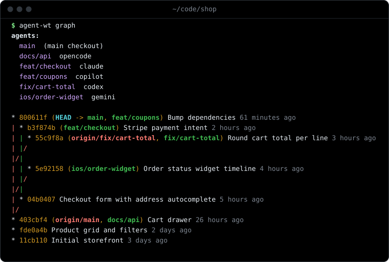</p>

### How a worktree is prepared

<p align="center">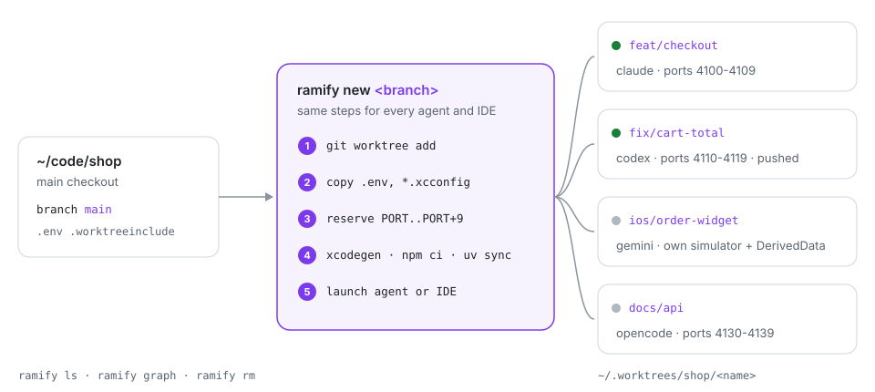</p>

1. **Worktree** in `~/.worktrees/<repo>/<name>`, outside the repository, so editors and file watchers in the main checkout never index it.
2. **Ignored files** listed in `.worktreeinclude` (gitignore syntax, the file Claude Code reads too) are copied, such as `.env`.
3. **Ports**: a block of 10 (`PORT` to `PORT+9`) starting at 4100.
4. **Setup**: `.worktree/setup.sh` if the project has one; otherwise `xcodegen generate`, `pnpm`/`yarn`/`bun`/`npm ci` or `uv sync`.
5. **Launch**: the agent in the worktree with `.worktree.env` exported, and/or your editor.

### Inside a worktree

Every worktree has a `.worktree.env`, excluded from git, that is exported into the agent:

| Variable       | Example                                  |
|----------------|------------------------------------------|
| `WT_NAME`      | `feat-login`                             |
| `WT_BRANCH`    | `feat/login`                             |
| `WT_PATH`      | `~/.worktrees/shop/feat-login`           |
| `WT_MAIN`      | `~/code/shop`                            |
| `WT_AGENT`     | `claude`                                 |
| `PORT`         | `4100` (use `4100` to `4109`)            |
| `DERIVED_DATA` | `~/.worktrees/shop/.derived-data/feat-login` |

Agents learn the rules from a short block in their global instructions:

```bash
ramify install instructions
```

It adds [`snippets/agent-instructions.md`](snippets/agent-instructions.md) once to every agent
that is installed: `~/.claude/CLAUDE.md`, `~/.codex/AGENTS.md`, `~/.gemini/GEMINI.md`,
`~/.config/opencode/AGENTS.md`, `~/.copilot/copilot-instructions.md` and `~/.config/amp/AGENTS.md`.
Nothing is written into your repositories.

### Project setup

```
your-repo/
├── .worktreeinclude          # ignored files to copy: .env, Local.xcconfig ...
└── .worktree/
    ├── setup.sh              # runs in each new worktree, with .worktree.env exported
    └── teardown.sh           # runs before the worktree is removed
```

Both scripts are optional and can stay untracked: Ramify also looks for them in the main checkout.
See [`examples/`](examples):

- [`ios-xcodegen`](examples/ios-xcodegen): `xcodegen generate` plus a dedicated simulator per
  worktree (`SIM_UDID`), deleted on removal.
- [`web`](examples/web): `npm ci` and a `.env.local` that pins Vite and the API to the worktree's ports.

### Claude Code integration

The plugin (see [Install](#install), or `ramify install claude-plugin`) registers Ramify as Claude Code's
`WorktreeCreate` and `WorktreeRemove` hooks, plus a guard that keeps the shared branch for you (edits, commits,
merges and pushes: see [What Ramify guarantees](#what-ramify-guarantees)).
Without the plugin, `ramify install claude-hooks` writes just the two worktree hooks into `~/.claude/settings.json`
(with a backup); installing the plugin later removes them, so they never run twice. From then on `claude --worktree`, background sessions, `/batch`,
workflows and subagents with `isolation: worktree` all create their worktrees through Ramify,
with the same layout, ports and setup as every other agent. Claude Code keeps subagent worktrees
after they finish, so run `ramify prune` now and then.

**Before editing, check nobody else is.** `ramify who <files or folders>` lists the other worktrees of the
repository that change them (committed, uncommitted or new), one per line as `branch, agent, working|idle, file`,
and exits 1 when there are any; without paths it checks the files the current worktree changes. The plugin's
`coordinar` skill runs it before a change and, on an overlap, tells you and can message the other Claude Code
session (`ListAgents` / `SendMessage`) instead of editing the same files.

**When a branch is done, say so.** `ramify ready`, run in its worktree with everything committed, brings `main` in
and checks the branches already marked ready. Exit 0: no other ready branch changes the same files, so this one is
marked ready to merge. Exit 1: one does; nothing is marked, and this branch waits for that one to be merged. Exit 2:
`main` conflicts with this branch; the merge is undone and the files are listed: merge `main`, resolve, commit and run
it again. `ramify ls` shows the queue in its READY column: `ready`, `stale` once the branch or `main` moved since, and
`wait` for a branch waiting its turn. With the plugin, Claude Code hears it in its next turn when `main` moves under a
branch marked ready or waiting; other agents see it in `ramify ls`, and the desktop app can notify you.

### Safety

- `rm` refuses when there are uncommitted changes, or commits that are neither merged nor pushed.
- `rm --force` discards uncommitted changes but **never deletes a branch with unmerged commits**:
  the worktree goes, the branch stays.
- `prune` only removes worktrees that are clean and already merged.
- The main checkout is never touched, except for one line in `.git/info/exclude` (`/.worktree.env`).

### What Ramify guarantees

Ramify keeps the default branch (`main`) for you: agents work on branches of their own and you decide what goes in.
Part of that is enforced; the rest is instructions the agents are given.

**Enforced**

- **Claude Code with the plugin.** In the main checkout on `main`, the guard refuses file edits and the git commands
  that change `main`: `commit`, `merge`, `cherry-pick`, `revert`, `am`, `rebase`, `reset --hard` and a `pull` of
  another branch. From any folder it refuses a push that updates `main` (`git push origin HEAD:main`, `:main`,
  `origin main`, `--all`, or a bare `git push` while on it). `fetch`, `pull --ff-only` and `--abort` still run.
  Claude Code cannot turn the guard off: a command that sets `ramify.allowMain` is refused too.
- **Any agent, with `ramify install guard`** in the repository (Codex, Gemini, Cursor, a plain terminal): git itself
  refuses `git commit` on `main` in the main checkout and any push that updates `main`, through the repository's
  pre-commit and pre-push hooks (which also scan for secrets when gitleaks is installed). Merging from the Ramify app
  is not affected: the app runs git without hooks.
- **The way out is yours:** `RAMIFY_ALLOW_MAIN=1` for one session or command, `git config ramify.allowMain true` for
  the repository.

**Instructions only** (the agent is told; nothing stops it)

- Writes from a terminal that do not commit (`echo > file`, `sed -i`, a script) in the main checkout. They stay as
  uncommitted changes, and `ramify move` takes them to a branch of their own.
- Edits and commits in another agent's worktree. Allowed on purpose, since one session may coordinate several:
  `ramify who` and the `coordinar` skill warn first.
- Agents started from an IDE or an app, without `ramify install guard`: they only have the rules from
  `ramify install instructions`.
- With `ramify install guard` alone, git hooks only see commits and pushes: a merge, rebase or reset of `main` in the
  main checkout goes through (pushing it does not), and `--no-verify` skips the hooks.

### Configuration

| Variable               | Default                                          |
|------------------------|--------------------------------------------------|
| `RAMIFY_ROOT`          | `~/.worktrees`                                   |
| `RAMIFY_PORT_MIN`      | `4100`                                           |
| `RAMIFY_PORT_MAX`      | `4990`                                           |
| `RAMIFY_FETCH_TIMEOUT` | `30` (seconds `ramify ready` waits for `origin`) |
| `NO_COLOR`             | unset                                            |

### Tests

```bash
bash tests/run.sh             # CLI, against throwaway repositories with stub agents (macOS and Linux)
npm run test:core             # engine, session detection, GitHub sign-in, IPC checks, timeline (also on Windows)
npm run test:e2e -w packages/core   # the real UI in Chromium: browser host, editor host, no clipping 390–1920px
```

All of them run in CI; the core suite, the Windows installer build and the checks of `ramify install guard`
(`bash tests/git-guard.sh` under Git Bash, also part of `tests/run.sh`) also run on Windows.

### Contributing

Issues and pull requests are welcome. Run the three test suites above before opening a PR; if you change
`ui/web`, rebuild it with `npm run build:web` and sync the plugin with `scripts/sync-plugin.sh`, which CI checks.


## License

[MIT](LICENSE). Brand marks of the tools Ramify works with are trademarks of their owners, shown only to identify them.
Icons come from [LobeHub Icons](https://github.com/lobehub/lobe-icons) (MIT), [Simple Icons](https://simpleicons.org) (CC0)
and [Devicon](https://devicon.dev) (MIT); `node scripts/brand-icons.mjs` regenerates them.
