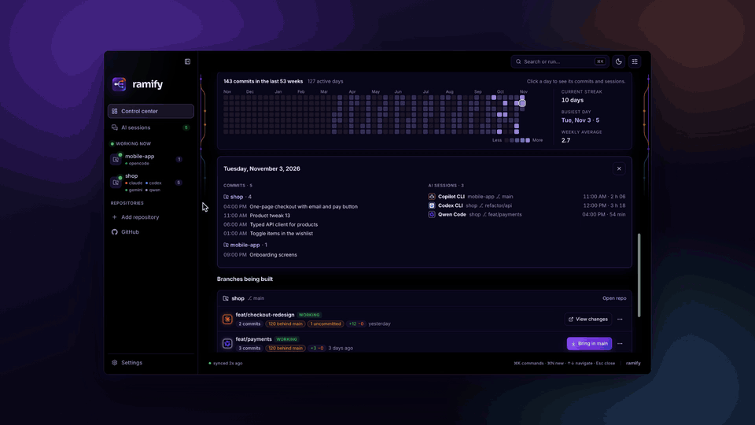
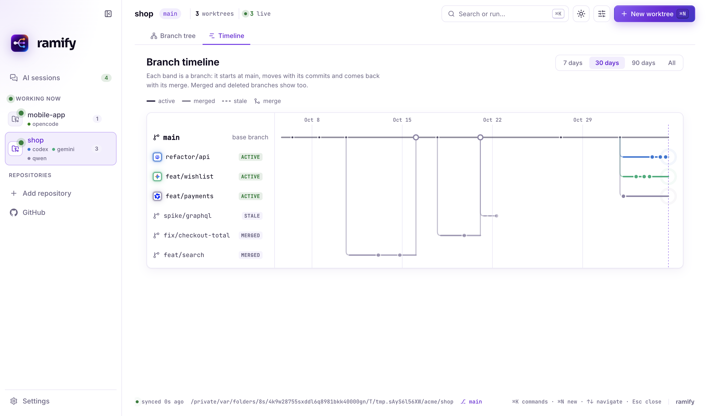

# Ramify for VS Code and Cursor

Run several AI coding agents on the same repository without them stepping on each other: each task gets its own
branch and folder (a git worktree), and one panel shows every branch, what each agent changed and what is ready to merge.

## What you get

- **Branch tree.** Every local branch of the repository at once, coloured by the agent working on it, with its
  uncommitted work shown on the tip of each branch (not only for the folder you have open).
- **What each agent changed.** Click a branch: its commits and files, and a GitHub-style diff of each file.
- **New worktree.** One step creates the branch and its folder, copies ignored files such as `.env`, installs
  dependencies, reserves its own ports and launches the agent in an editor terminal.
- **Merge or remove** a branch from the panel. Ramify refuses to delete anything that is not committed or merged.
- **Timeline.** One band per branch, from where it forked to where it was merged, merged branches included.
- **Status bar.** How many worktrees the repository has and how many agents are working right now.

The panel is the same one as the Ramify desktop app, inside the editor, and it follows the editor's light or dark theme.

## Commands

| Command | Shortcut |
| --- | --- |
| Ramify: Open dashboard | `Cmd+Alt+W` (macOS), `Ctrl+Alt+W` |
| Ramify: New worktree | |

The status bar item opens the dashboard too.

## Requirements

- A folder inside a git repository, opened as a **trusted** workspace: Ramify runs git and your project's setup
  scripts, so it stays off in Restricted Mode.
- `git` and `bash` (on Windows, Git Bash).

## Private by design

Local-first, no telemetry: nothing about your code, prompts or sessions leaves your computer.

More, including the desktop app, the CLI and the Claude Code plugin: [github.com/diegoperezg7/ramify](https://github.com/diegoperezg7/ramify).
